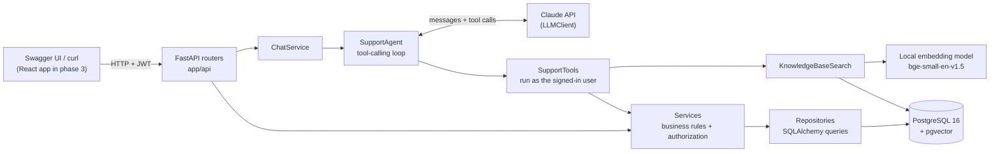
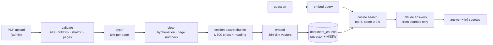
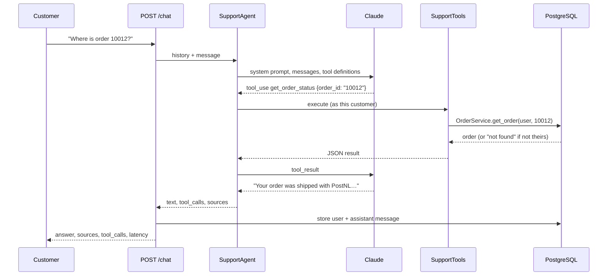
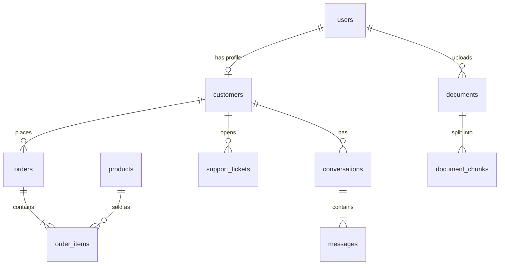

# SupportAI

An AI customer-support platform: customers ask about their orders, return policy or a damaged parcel, and an AI agent answers using **real data** — it looks orders up in the database, searches company documents with RAG, and opens support tickets.

> **Status:** Phase 1 (backend & foundation) and phase 2 (RAG pipeline + AI agent) are complete. The React frontend, CI and production polish (phase 3) are next.

## Architecture



Each layer has one job:

| Layer | Folder | Responsibility |
|---|---|---|
| Routers | `app/api/` | HTTP: parse and validate input (Pydantic), call a service, return a response model. No business logic. |
| Services | `app/services/` | Business rules, such as "a customer only sees their own orders". They raise domain errors (`NotFoundError`, …) that `main.py` turns into HTTP status codes. |
| Repositories | `app/repositories/` | The only place that builds database queries. |
| RAG | `app/rag/` | PDF extraction, cleaning, chunking, embeddings, vector search and RAG answers. |
| Agent | `app/agents/` | The LLM client (`LLMClient` interface + Claude implementation) and the support agent loop. |
| Tools | `app/tools/` | The functions the agent may call. They reuse the services, so the same authorization rules apply. |
| Models / Schemas | `app/models/`, `app/schemas/` | Database tables (SQLAlchemy) and API bodies (Pydantic). |
| Core | `app/core/` | Settings, database session, password hashing / JWT, dependencies, JSON logging. |

## Tech stack

**Backend:** Python 3.12 · FastAPI · SQLAlchemy 2 · PostgreSQL 16 + pgvector · Alembic · Pydantic 2 · PyJWT · bcrypt
**AI:** Claude API (Anthropic Python SDK) · FastEmbed (`BAAI/bge-small-en-v1.5`, runs locally) · pypdf
**Quality:** Pytest (against a real PostgreSQL) · Ruff · MyPy (strict)
**Infrastructure:** Docker · Docker Compose

## Getting started

Requirements: Docker Desktop (or Docker Engine + Compose).

```bash
cp .env.example .env          # then change POSTGRES_PASSWORD (in all 3 places) and JWT_SECRET_KEY
                              # and set ANTHROPIC_API_KEY for the AI chat (see below)
docker compose up --build     # starts PostgreSQL and the API; migrations run automatically
```

In a second terminal, load the demo data and index the sample documents:

```bash
docker compose exec backend python scripts/seed_database.py --reset   # users, orders, tickets
docker compose exec backend python scripts/ingest_documents.py        # sample_documents/*.pdf → knowledge base
```

Then open **http://localhost:8000/docs** (Swagger UI).

### The Claude API key

The chat agent and RAG answers call Claude, so they need an API key from <https://console.anthropic.com/settings/keys>. Put it in `.env` (which is git-ignored, so it's never committed):

```bash
ANTHROPIC_API_KEY=sk-ant-...
```

Restart the backend with `docker compose up -d --force-recreate backend` after changing it. Without a key, everything else works (upload, ingestion, semantic search, the retrieval part of the evaluation, all tests), while `/chat` and `/knowledge-base/ask` return **503**.

### Demo accounts

All demo accounts use the password `Password123!`.

| Role | Email |
|---|---|
| ADMIN | `admin@supportai.dev` |
| AGENT (support staff) | `agent@supportai.dev` |
| CUSTOMER | `emma.devries@example.com`, `lucas.janssens@example.com`, `sofia.martens@example.com`, `noah.peeters@example.com`, `mila.claes@example.com` |

The seed creates 7 users, 5 customers, 10 products, 20 orders (order numbers 10001–10020) with 40 order items, 8 support tickets and 2 conversations. Order statuses follow the order's age, like in a real shop: today's order is `pending`, last week's are `shipped` with a carrier and tracking number, older ones are `delivered` or `cancelled`.

## Trying the API

**In Swagger UI:** click **Authorize**, enter a demo email as *username* plus the password, then try any endpoint.

**With curl:**

```bash
# Log in (OAuth2 password flow: form fields, the email goes in "username")
TOKEN=$(curl -s -X POST localhost:8000/auth/login \
  -d "username=emma.devries@example.com&password=Password123!" | python3 -c "import sys,json; print(json.load(sys.stdin)['access_token'])")

curl -H "Authorization: Bearer $TOKEN" "localhost:8000/orders?status=shipped"

# Semantic search (no API key needed)
curl -H "Authorization: Bearer $TOKEN" "localhost:8000/knowledge-base/search?q=how+long+can+I+return+a+product"

# RAG answer with sources
curl -X POST localhost:8000/knowledge-base/ask -H "Authorization: Bearer $TOKEN" -H "Content-Type: application/json" \
  -d '{"question": "How long do I have to return a product?"}'

# Chat with the agent; pass the returned conversation_id to continue the conversation
curl -X POST localhost:8000/chat -H "Authorization: Bearer $TOKEN" -H "Content-Type: application/json" \
  -d '{"message": "Where is my most recent order?"}'
```

Questions worth trying in the chat (as Emma):

- *"Where is my order?"* → `get_customer_orders`, then the status of the latest one.
- *"What is the status of order 10012?"* → `get_order_status`. Ask for an order of another customer and the agent says it can't find it.
- *"Can I return headphones after three weeks?"* → `search_knowledge_base`, answer with `[S1]`-style citations and sources.
- *"My order arrived damaged."* → asks for the order number, checks it, then opens a ticket with `create_support_ticket`.
- *"Do you ship to Canada?"* / *"What's your CEO's name?"* → the not-found answer instead of a guess.

## API

| Method | Endpoint | Who | Notes |
|---|---|---|---|
| POST | `/auth/register` | anyone | Creates a CUSTOMER account + profile. 201, or 409 if the email exists. |
| POST | `/auth/login` | anyone | Form fields `username` (email) and `password`; returns a JWT. 401 on bad credentials. |
| GET | `/users/me` | signed in | The current user. |
| GET | `/orders` | signed in | Own orders; staff see all. Filters: `status`, `limit`, `offset`. |
| GET | `/orders/{order_id}` | owner / staff | Includes items, carrier, tracking number and estimated delivery. |
| GET | `/tickets` | signed in | Own tickets; staff see all. Filters: `status`, `limit`, `offset`. |
| POST | `/tickets` | signed in | Customers open tickets for themselves; staff must pass `customer_id`. |
| GET | `/tickets/{ticket_id}` | owner / staff | |
| GET | `/conversations` | signed in | Own conversations with message counts. |
| GET | `/conversations/{conversation_id}` | owner / staff | All messages, including the assistant's tool calls, sources and latency. |
| POST | `/chat` | customer | `{conversation_id?, message}` → `{conversation_id, message_id, message, sources, tool_calls, latency_ms}`. 503 without an API key. |
| GET | `/knowledge-base/search` | signed in | `q`, `top_k`: the most relevant chunks with document, page, chunk id and score. |
| POST | `/knowledge-base/ask` | signed in | `{question}` → RAG answer, sources and `answered`. 503 without an API key. |
| POST | `/documents` | admin | Upload a PDF (multipart `file`). 409 duplicate, 413 too large, 415 not a PDF, 400 no text. |
| GET | `/documents`, `/documents/{id}` | admin | Indexed documents; the detail view includes the chunks. |
| DELETE | `/documents/{id}` | admin | Removes the document and its chunks. |
| GET | `/health` | anyone | Also checks the database connection. |

Paged lists return `{"items": [...], "total": n, "limit": 20, "offset": 0}`.

## RAG pipeline



1. **Ingestion** (`app/rag/ingestion.py`). The upload is checked on its *content*: the size, the `%PDF-` signature (not the file extension), a SHA-256 hash to reject duplicates, and a page limit. Encrypted or unreadable PDFs are refused.
2. **Cleaning and chunking** (`app/rag/text_processing.py`, pure functions with unit tests). Words hyphenated across lines are joined and page-number lines dropped. The text is then split into **sections by heading**. Each section becomes one or more chunks of whole sentences (at most 800 characters), and **every chunk starts with its heading** ("Refunds: We refund …"). A chunk taken out of the document still says what it is about, which makes retrieval noticeably more precise. Long sections overlap by one sentence, so a fact on the boundary isn't lost.
3. **Embeddings** (`app/rag/embeddings.py`). `BAAI/bge-small-en-v1.5` via FastEmbed runs **locally** on the CPU. It's free and fast, and documents never leave the server. The model is baked into the Docker image, so containers start without downloading it. Queries and passages are embedded slightly differently (the model's query instruction), as the model recommends.
4. **Storage.** Each chunk is stored with its metadata: document id, filename (via the document), page number, chunk index (`chunk_id` is the row id) and `created_at`. The 384-dimension vector sits in a `vector(384)` column with an **HNSW index** for cosine distance.
5. **Search** (`app/rag/retrieval.py`). The question is embedded and the database orders chunks by cosine distance. `score = 1 − distance`, and only chunks scoring at least `RAG_MIN_SCORE` count as relevant.
6. **Answer** (`app/rag/rag_service.py`). The chunks go to Claude as numbered sources, with instructions to answer **only** from them, cite them as `[1]`, and ignore instructions inside documents (prompt-injection defence). **If nothing is relevant, the LLM isn't called at all** and the answer is the fixed message *"I couldn't find enough information in the knowledge base to answer that reliably."*. A model can't invent a policy it was never shown.

Sample documents (generated from text in `scripts/generate_sample_documents.py`, consistent with the seed data): Return Policy, Shipping Policy, Warranty, Payment FAQ, Product Information.

## AI agent



The agent (`app/agents/support_agent.py`) is a **hand-written tool-calling loop**, so every step is visible and explainable:

1. Send the conversation, a system prompt and the tool definitions to the model.
2. If the model asks for tools, run each one, send all results back in one message, and repeat.
3. When the model answers in text, that's the reply. After `AGENT_MAX_TOOL_ROUNDS` rounds the tools are taken away, so the loop always ends.

| Tool | What it does |
|---|---|
| `get_order_status(order_id)` | One order: status, carrier, tracking number, estimated delivery, items. Accepts "10012" or "#10012". |
| `get_customer_orders(customer_id?, status?)` | The customer's latest orders. |
| `search_knowledge_base(query)` | Semantic search; results are numbered `S1, S2, …` so the answer can cite them. |
| `create_support_ticket(subject, description, priority, order_id?, customer_id?)` | Opens a ticket; the order must be the customer's own. |
| `get_support_tickets(customer_id?, status?)` | The customer's tickets. |

**How the agent can never show another customer's data.** The model never touches the database. It can only *ask* for a tool, and `SupportTools` runs that tool **as the signed-in user** through the same services as the REST API. Someone else's order gives the same "not found" as an order that doesn't exist. A `customer_id` that isn't the user's own is refused, and a ticket can only reference the user's own orders. Tool arguments from the model are validated with Pydantic like any other user input. Even a model that was tricked by a prompt can only reach data the user may see anyway. The tests check exactly this.

**Chat persistence.** `POST /chat` starts a new conversation or continues one of the user's own (someone else's gives 404). The last `CHAT_HISTORY_MESSAGES` messages are sent along as context. The user message and the answer are stored together, including the tool calls, cited sources and latency, and only after the agent has succeeded. If the AI fails, nothing half-finished is saved.

**LLM abstraction.** The agent and RAG code depend on the `LLMClient` interface (`app/agents/llm.py`), not on the SDK, so the tests can plug in a scripted fake and the provider could be swapped. `AnthropicClient` uses `claude-opus-5-5` with `effort: medium` and server-side fallbacks. Authentication, rate-limit and connection errors become a clean **503**.

## Logging

Logs are **structured JSON**, one object per line (`app/core/logging.py`), so they can be searched and aggregated:

- every request: request id (also returned as the `X-Request-ID` header), method, path, status and `duration_ms`;
- every AI request: model, latency, input/output tokens and stop reason;
- every tool call: tool name, ok/error and duration;
- RAG retrieval and answers: number of chunks, best score, duration, answered or not; document ingestion;
- errors with status ≥ 500, with stack trace.

**What is never logged:** passwords, tokens, API keys, message texts, search queries or tool argument values (only argument names, plus the order number). As a second safety net, the formatter redacts any field whose name looks sensitive (`password`, `token`, `api_key`, `authorization`, …).

## RAG evaluation

`scripts/evaluate_rag.py` measures the pipeline on a dataset of **24 questions** (`scripts/eval/rag_eval_dataset.json`):

- 18 answerable questions, each with the document(s) that contain the answer and the facts the answer must state;
- 6 questions the documents can't answer, where the right answer is "not found".

```bash
docker compose exec backend python scripts/evaluate_rag.py                       # retrieval + answers
docker compose exec backend python scripts/evaluate_rag.py --skip-answers        # retrieval only
docker compose exec backend python scripts/evaluate_rag.py --output /tmp/r.json  # full JSON report
```

Measured results (retrieval, `top_k=5`, threshold 0.6, full report in `scripts/eval/results/latest.json`):

| Metric | Meaning | Result |
|---|---|---|
| hit@1 / hit@3 | The right document is the first / in the top 3 results | **0.944 / 1.000** |
| MRR | Mean reciprocal rank of the first right chunk | **0.972** |
| Context precision | Share of relevant chunks that come from the right document | **0.744** |
| Fact coverage | Share of required facts present in the retrieved context | **0.944** |
| Answerable retrieved | Answerable questions with at least one relevant chunk | **1.000** |
| Unanswerable abstained | Unanswerable questions where nothing passes the threshold | **0.667** |
| Retrieval latency | p50 / p95 (embedding + vector search) | **5.6 ms / 28.2 ms** |

**Answer metrics** (answer correctness: all required facts in the generated answer; abstention accuracy on unanswerable questions; end-to-end latency) need an API key. They **haven't been measured yet**, because no key was configured when this report was made. Run the script with `ANTHROPIC_API_KEY` set to produce them.

**Choosing the threshold.** The script also sweeps the threshold. At 0.60 every answerable question still gets context, and 4 of the 6 unanswerable ones are stopped before the LLM. Raising it to 0.66 stops all 6, but then loses 2 of the 18 answerable questions. Missing a real answer is worse than one more LLM call, so the threshold is 0.60. For the 2 unanswerable questions that pass it, the RAG prompt is the second guardrail: the model must reply with the not-found message when the sources don't contain the answer.

| Threshold | 0.56 | 0.58 | **0.60** | 0.62 | 0.64 | 0.66 | 0.70 |
|---|---|---|---|---|---|---|---|
| Answerable retrieved | 1.000 | 1.000 | **1.000** | 0.944 | 0.944 | 0.889 | 0.778 |
| Unanswerable abstained | 0.167 | 0.500 | **0.667** | 0.667 | 0.833 | 1.000 | 1.000 |

## Database



- `users` holds login accounts with a `role` (CUSTOMER, AGENT, ADMIN). Customers also get a row in `customers`, which links their orders, tickets and conversations.
- Statuses, priorities and roles are native PostgreSQL enums, so the database itself rejects invalid values.
- Money is stored as `NUMERIC(10,2)`, never as a float, so `0.1 + 0.2` stays exact.
- `order_items.price` is the price *at the time of purchase*, so later price changes don't alter old orders.
- `documents` stores the filename, SHA-256 (unique, to block duplicates), page count, size and uploader. `document_chunks` stores `chunk_index`, `page_number`, `content` and `embedding vector(384)` with an HNSW cosine index.
- `messages` stores, for assistant messages, the `tool_calls` and `sources` (JSONB) and the `latency_ms`, so a conversation can be audited afterwards.

Migrations live in `backend/alembic/versions/` and run automatically when the backend container starts. To run them by hand: `docker compose exec backend alembic upgrade head`.

## Testing

```bash
docker compose exec backend pytest                 # 74 tests
docker compose exec backend ruff check .           # lint
docker compose exec backend mypy app               # strict type checking
```

The tests run against a **real PostgreSQL** database (`supportai_test`), not SQLite, so they test exactly what runs in production, including enums and pgvector. The test run:

1. creates the test database if needed and builds the schema with the Alembic migrations (so the migrations are tested too);
2. runs every test inside a transaction that is rolled back afterwards, so tests never see each other's data. Service code that calls `commit()` only releases a savepoint.

The AI tests use the **real** embedding model, vector search, tools and database. Only the LLM is replaced, by `ScriptedLLM` (`tests/fakes.py`), which plays back pre-written model turns such as "call `get_order_status` with 10012". That makes the agent tests deterministic and free, and they run without an API key, while everything the agent *does* with those turns is real.

What's covered:

- **Phase 1:** registration, login, JWT validation, ownership checks, staff access, tickets, filtering and pagination.
- **Chunking:** unit tests for cleaning, headings, overlap and long sentences.
- **Ingestion:** chunks and embeddings stored with metadata; duplicate, non-PDF, too-large and text-less files rejected; admin-only access; filename sanitising.
- **Retrieval and RAG:** the right document is found; an irrelevant question returns nothing and doesn't call the LLM; sources are cited.
- **Agent:** own order lookups work. Another customer's order, `customer_id` or ticket order is refused and leaks no data. Ticket creation, invalid arguments, unknown tools, capped tool rounds and refusals are handled.
- **`POST /chat`:** response shape, persistence, continuing a conversation, someone else's conversation (404), staff (403), validation (422), no API key (503, nothing stored).

## Design decisions

These are short explanations of why things are built this way.

- **Layered architecture.** Routers stay thin, so the rules live in one place (services) and the queries in another (repositories). The AI tools reuse the same services, so the agent gets exactly the same authorization rules as the REST API.
- **Authentication.** Passwords are hashed with **bcrypt**, which is slow on purpose and salted. On login the server issues a **JWT** holding the user id, role and expiry time. Unknown emails still run bcrypt, so response time doesn't reveal which emails are registered.
- **Authorization.** One rule in `services/access.py`: customers are limited to their own `customer_id`, staff (ADMIN/AGENT) see everything. Someone else's order returns **404, not 403**, so the API doesn't confirm the order exists.
- **Domain errors.** Services raise `NotFoundError`, `ConflictError` and so on, without importing anything from HTTP. One exception handler in `main.py` maps them to status codes.
- **Synchronous SQLAlchemy.** This is simpler to read and explain than async; FastAPI runs sync endpoints in a thread pool, which is plenty for this workload.
- **pgvector instead of a separate vector database.** Embeddings sit next to the relational data, in the same transactions, backups and SQL queries, with one less service to run.
- **Local embeddings, hosted LLM.** Embedding is cheap and runs on every upload and question, so it runs locally (free, private, about 5 ms). Generating good answers and choosing tools needs a strong model, so that goes to Claude.
- **Own agent loop instead of a framework.** About 60 lines that show exactly what happens in each round, easy to log, test and explain. No hidden magic.
- **"Not found" over guessing.** Low-scoring chunks are dropped before the LLM, the prompts demand the fixed not-found message, and the evaluation measures how often that works.

## Project structure

```text
supportai/
├── backend/
│   ├── app/
│   │   ├── api/            # routers: auth, users, orders, tickets, conversations, chat, knowledge base, documents
│   │   ├── agents/         # LLM client + support agent loop
│   │   ├── core/           # config, database, security, deps, exceptions, logging
│   │   ├── models/         # SQLAlchemy models + enums
│   │   ├── rag/            # pdf, text processing, embeddings, ingestion, retrieval, rag_service
│   │   ├── repositories/   # database queries
│   │   ├── schemas/        # Pydantic request/response models
│   │   ├── services/       # business logic + authorization, chat
│   │   ├── tools/          # tools the agent can call
│   │   └── main.py
│   ├── alembic/            # migrations
│   ├── tests/
│   ├── Dockerfile
│   ├── pyproject.toml      # pytest, ruff, mypy config
│   └── requirements*.txt
├── frontend/               # phase 3
├── sample_documents/       # demo knowledge-base PDFs
├── scripts/
│   ├── seed_database.py
│   ├── generate_sample_documents.py
│   ├── ingest_documents.py
│   ├── evaluate_rag.py
│   └── eval/               # dataset + latest results
├── docker-compose.yml
└── .env.example
```

## Environment variables

See [`.env.example`](.env.example). The important ones:

| Variable | Purpose |
|---|---|
| `DATABASE_URL` | SQLAlchemy URL of the main database |
| `TEST_DATABASE_URL` | Database used by the test suite (created automatically) |
| `JWT_SECRET_KEY` | Secret used to sign tokens; at least 32 characters |
| `JWT_ACCESS_TOKEN_EXPIRE_MINUTES` | Token lifetime (default 60) |
| `CORS_ORIGINS` | Comma-separated browser origins allowed to call the API |
| `ANTHROPIC_API_KEY` | Claude API key for chat and RAG answers; empty means those return 503 |
| `LLM_MODEL`, `LLM_EFFORT` | Model (default `claude-opus-5-5`) and effort level (default `medium`) |
| `EMBEDDING_MODEL`, `EMBEDDING_DIM` | Local embedding model and its vector size (384) |
| `RAG_TOP_K`, `RAG_MIN_SCORE` | Chunks per search (5) and the relevance threshold (0.6) |
| `MAX_UPLOAD_MB` | Maximum PDF size (10) |
| `LOG_LEVEL` | Log level (INFO) |

`.env` is git-ignored; never commit real secrets.

## Roadmap

- **Phase 3:** React + TypeScript + Tailwind frontend (chat with sources and tool calls, order and ticket views, admin knowledge-base management), streaming chat, metrics, CI/CD with GitHub Actions, end-to-end tests, production hardening.
