# Invixta

A web shop for football shirts with an AI support assistant built in. You can pick a club, choose your size, have your name and number printed on the back, pay, and follow the order to your door. When you have a question ("Where is my order?", "Which size should I take?", "Can I return a printed shirt?"), the assistant answers from **real data**: it looks the order up in PostgreSQL, searches the shop's policy documents with RAG, checks the stock, and opens tickets.

The AI runs **locally** in [Ollama](https://ollama.com): no API key, no costs. Two parts still stand in for outside services (see [Going live](#going-live)): no payment provider is connected yet, so the payment page runs in **test mode**, and a fulfillment simulator plays the warehouse and the carrier. The clubs, leagues and crests in the demo catalogue are made up, so there are no licensing issues.

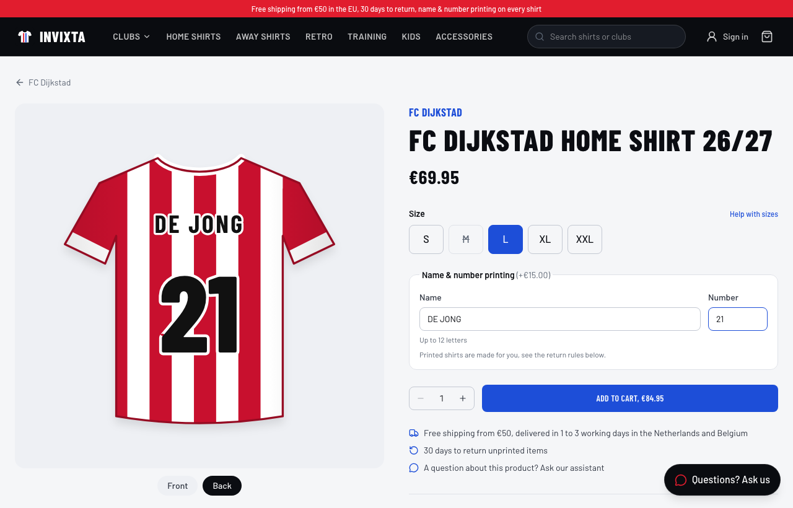

## Overview

Invixta grew out of SupportAI, an AI customer-support platform, and adds a complete shop around it:

- **Shop:** a catalogue of 12 clubs in two leagues, shirts drawn as SVG in each club's colours and pattern, sizes with their own stock, name and number printing with a live preview, a cart (also for guests), checkout and payment.
- **Orders that move:** a fulfillment simulator ships paid orders after a few minutes, with a carrier and a tracking number, and then delivers them. The order page shows it happening.
- **Support assistant:** in a widget on every shop page and as a full chat. It answers with what it finds in the database and the documents, shows the steps a customer cares about ("Checked your order: Order #10014: shipped"), and names the help articles it used.
  - **Human in the loop:** it can *offer* to cancel an order, but only the customer's click on the button cancels it.
- **Admin:** products, prices, sales and stock per size; the knowledge base (PDF upload); tickets; and metrics for the shop and the assistant.

## Features

**Customers**
- Browse by club, league, category, size in stock, price and sale; search; sort by popularity (real sales), newness or price.
- Product page with sizes (sold out, "only 2 left") and printing, with your name and number on the shirt as you type (+€15).
- Cart drawer and cart page with a free-shipping bar; a guest cart is merged into your account when you sign in.
- Checkout with a server-side quote:
  - shipping is free from €50, otherwise €4.95 in the Benelux and €9.95 elsewhere in the EU;
  - express costs €7.50 extra and is only available in NL and BE.
- Payment page (Invixta Pay, marked *Test mode* until a provider is connected): pay or cancel. A cancelled or failed payment can be retried from the order page.
- Order page with a live timeline (ordered → paid → shipped → delivered), printed items, address, tracking. You can cancel until the order ships.
- The AI assistant (widget and full chat), support tickets, profile and password change.

**Support agents** see all orders and handle tickets. **Admins** also manage products, prices, sales and stock, the knowledge base, and see the metrics.

## Architecture

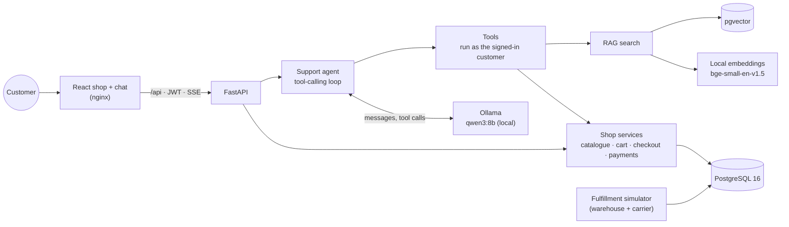

The backend has one job per layer:

| Layer | Folder | Responsibility |
|---|---|---|
| Routers | `backend/app/api/` | HTTP only: validate input (Pydantic), call a service, return a response model. |
| Services | `backend/app/services/` | Business rules: pricing, cart, checkout, payments, cancelling, fulfillment, authorization ("a customer only sees their own orders"). |
| Repositories | `backend/app/repositories/` | The only place that builds database queries. |
| RAG | `backend/app/rag/` | PDF extraction, chunking, embeddings, query rewriting, vector search, RAG answers. |
| Agent | `backend/app/agents/` | The `LLMClient` interface, the Ollama client, the agent loop and the scripted test model. |
| Tools | `backend/app/tools/` | What the agent may call. Tools reuse the services, so the agent gets exactly the API's rules. |
| Core | `backend/app/core/` | Settings, database, security, dependencies, rate limiting, JSON logging. |

The frontend is a React single-page app. `src/api/` holds a typed client with one function per endpoint and the SSE reader; `src/cart/` the cart state; `src/components/shop/` the storefront, including the SVG shirt drawing (`Jersey.tsx`); `src/pages/` one file per page. In Docker, nginx serves it and forwards `/api/*` to FastAPI, so the browser talks to one origin.

## Tech Stack

| | |
|---|---|
| **Backend** | Python 3.12, FastAPI, SQLAlchemy 2, PostgreSQL 16 + pgvector, Alembic, Pydantic 2, PyJWT, bcrypt |
| **AI** | Ollama with `qwen3:8b` (local) behind an `LLMClient` interface, FastEmbed (`BAAI/bge-small-en-v1.5`, local), pypdf |
| **Frontend** | React 19, TypeScript, Tailwind CSS 4, React Router, Vite |
| **Testing** | Pytest (real PostgreSQL), Vitest + Testing Library, Playwright |
| **Quality** | Ruff, MyPy (strict), oxlint, tsc |
| **Infrastructure** | Docker Compose (postgres, backend, simulator, frontend/nginx), GitHub Actions |

Why these choices:

- **pgvector:** embeddings live next to the orders, in the same database, transactions and backups.
- **Everything local, nothing paid:** embeddings run in the app, the language model in Ollama on the same machine, so customer data never leaves it. The trade-off is that a small local model is less capable than a large hosted one, which shaped the agent's design (see below).
- **A hand-written agent loop**, not a framework, so every step can be read, logged, tested and explained.
- **Prices are always calculated on the server:** the cart, the quote and the checkout use the same pricing functions (`services/pricing.py`); the browser never sends a price.

## Screenshots

| | |
|---|---|
| 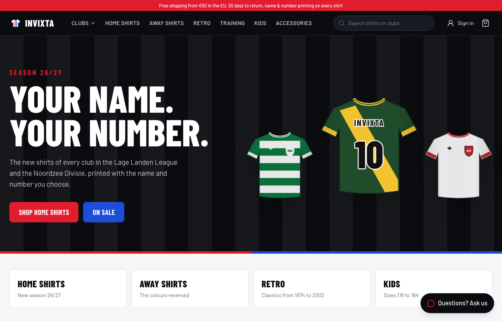 **Home: the new season** | 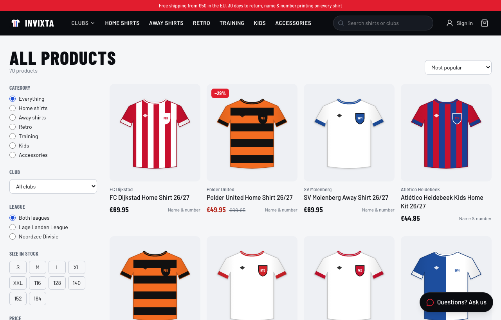 **Catalogue with filters** |
| 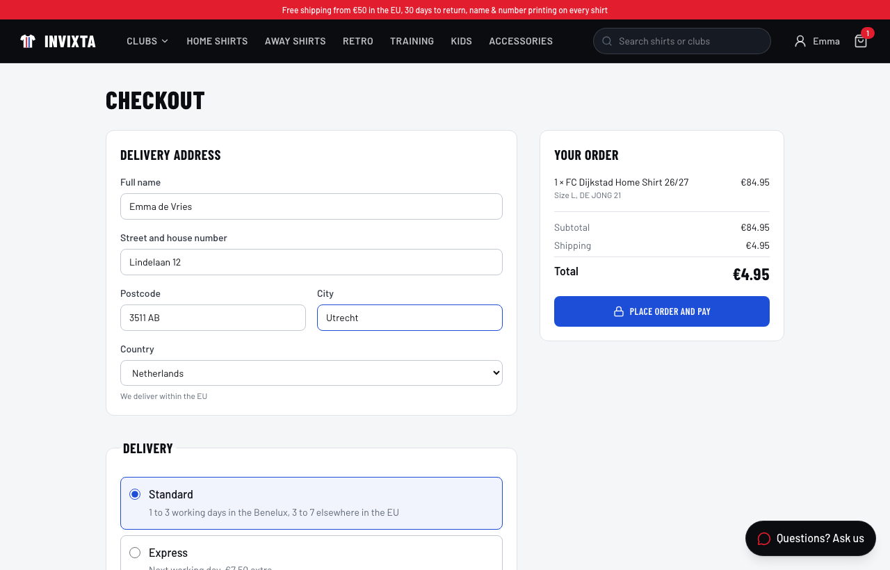 **Checkout with a server-side quote** | 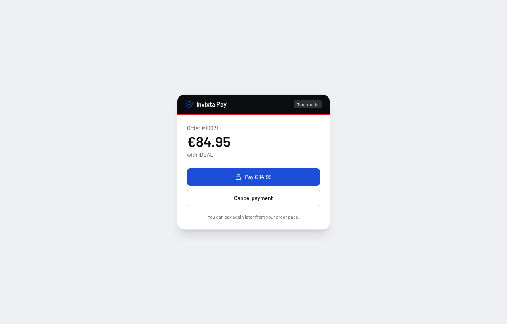 **The payment page (test mode)** |
| 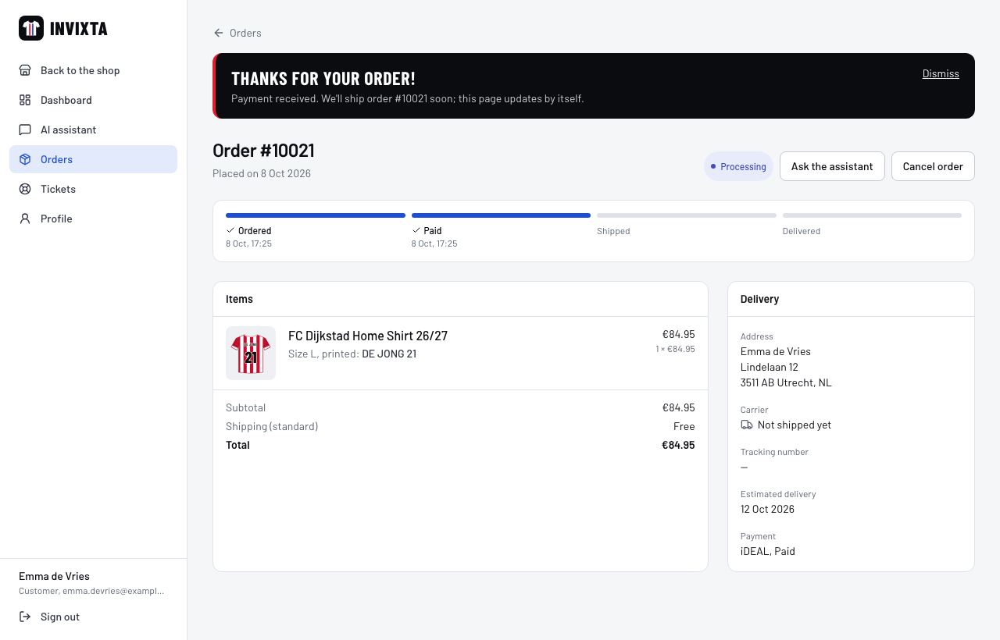 **Order page with a live timeline** | 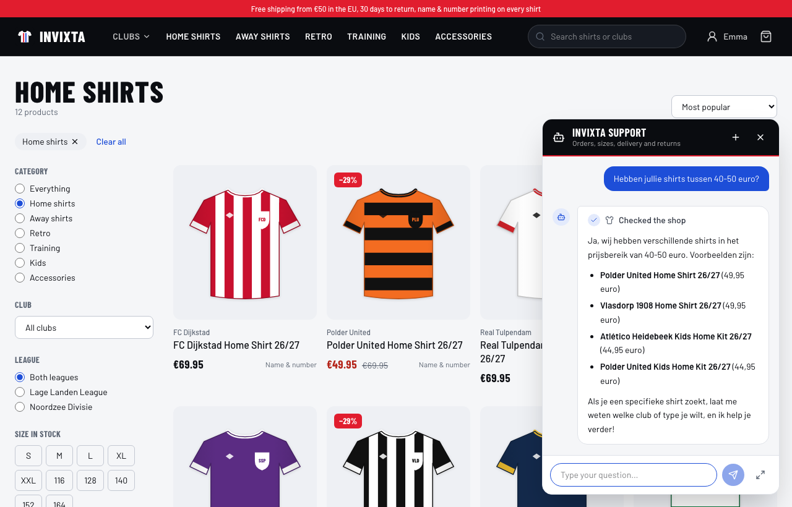 **The assistant in the shop** |
| 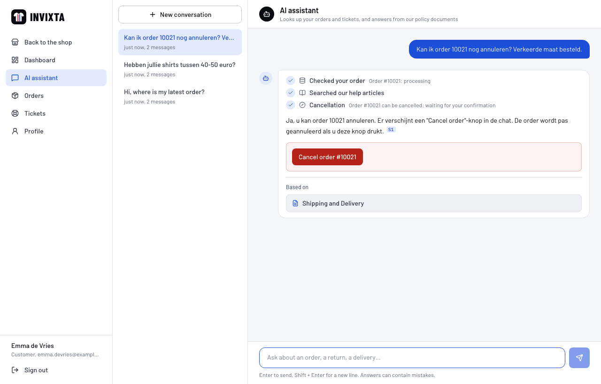 **Cancelling: the assistant offers, you confirm** | 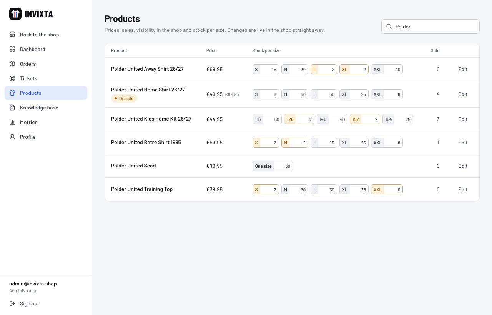 **Admin: prices and stock per size** |

The assistant's answers in these screenshots come from `qwen3:8b` running in Ollama.

## Project Structure

```text
invixta/
├── backend/
│   ├── app/
│   │   ├── api/            # auth, catalog, cart, checkout (+ payments), orders, tickets, chat, knowledge base, documents, admin
│   │   ├── agents/         # LLM interface, Ollama client, support agent, scripted test model
│   │   ├── core/           # config, database, security, deps, exceptions, rate limiting, logging
│   │   ├── models/         # teams, products, sizes, carts, orders, payments, tickets, conversations, documents
│   │   ├── rag/            # pdf, chunking, embeddings, query rewriting, retrieval, RAG answers
│   │   ├── repositories/   # database queries
│   │   ├── schemas/        # request/response models
│   │   ├── services/       # pricing, cart, checkout, fulfillment, orders, tickets, chat, metrics, admin catalogue
│   │   └── tools/          # the agent's tools
│   ├── alembic/            # migrations
│   └── tests/              # pytest
├── frontend/
│   ├── src/                # api, auth, cart, components (shop, chat), pages (shop, account, admin)
│   ├── e2e/                # Playwright: shop flow and support flow
│   └── nginx.conf          # static files, /api proxy (SSE), security headers
├── scripts/
│   ├── seed_database.py    # demo data: 12 clubs, 70 products, 285 sizes, customers, orders, tickets
│   ├── catalog_data.py     # the demo catalogue: clubs, leagues, products
│   ├── fulfillment_simulator.py
│   ├── generate_sample_documents.py, ingest_documents.py
│   └── evaluate_rag.py     # + eval/ dataset and results
├── sample_documents/       # the knowledge base: returns, shipping, sizes, printing, payments, care
├── docs/screenshots/
├── docker-compose.yml      # postgres + backend + simulator + frontend
├── docker-compose.prod.yml # production override: only the shop published, no dev tools, docs off
└── docker-compose.e2e.yml  # override for end-to-end tests (scripted model)
```

## Getting Started

Requirements:

- [Docker Desktop](https://www.docker.com/products/docker-desktop/);
- [Ollama](https://ollama.com) with `qwen3:8b`, which needs about 6 GB of disk and runs well with 16 GB RAM;
- Node.js 24, only for the end-to-end tests or frontend development.

1. **Install Ollama and the model** (once):

   ```bash
   brew install ollama          # macOS; other systems: https://ollama.com/download
   brew services start ollama   # runs in the background, also after a restart
   ollama pull qwen3:8b
   ```

2. **Configure:** `cp .env.example .env`, then change `POSTGRES_PASSWORD` (it appears in 3 places) and set a random `JWT_SECRET_KEY` (`python3 -c "import secrets; print(secrets.token_urlsafe(48))"`). `.env` is git-ignored.

3. **Start everything:**

   ```bash
   docker compose up --build
   ```

4. **Load the demo shop and the knowledge base** (in a second terminal):

   ```bash
   docker compose exec backend python scripts/seed_database.py --reset
   docker compose exec backend python scripts/ingest_documents.py
   ```

5. **Open the shop:** <http://localhost:4000>. Swagger UI is at <http://localhost:8100/docs>. The ports differ from SupportAI's, so both can run at the same time.

| Role | Email | Password |
|---|---|---|
| Customer | `emma.devries@example.com` (also `lucas.janssens@`, `sofia.martens@`, `noah.peeters@`, `mila.claes@example.com`) | `Password123!` |
| Support agent | `agent@invixta.shop` | `Password123!` |
| Admin | `admin@invixta.shop` | `Password123!` |

**Is the AI ready?** <http://localhost:8100/health> shows `"llm": "ok"`:

- `"unreachable"` means Ollama isn't running: `brew services start ollama`.
- `"model_missing"` means the model isn't downloaded: `ollama pull qwen3:8b`.

The first answer after a while takes 10–30 s, because Ollama loads the model into memory first.

**Try the whole journey:**

1. Pick a shirt and type your name and number.
2. Check out and press *Pay* on the payment page (test mode).
3. Watch the order page: after about 3 minutes the order is shipped with a tracking number, after about 10 minutes it's delivered. The timings are `SIMULATION_*_MINUTES` in `.env`.
4. Ask the assistant in the corner about it.

## Environment Variables

All settings are in [`.env.example`](.env.example). The important ones:

| Variable | Purpose |
|---|---|
| `POSTGRES_*`, `DATABASE_URL`, `TEST_DATABASE_URL` | Database credentials and URLs |
| `ENVIRONMENT` | `production` refuses the placeholder JWT secret and the scripted test model, and switches off `/docs` |
| `JWT_SECRET_KEY`, `JWT_ACCESS_TOKEN_EXPIRE_MINUTES` | Token signing secret (≥ 32 characters) and lifetime |
| `OLLAMA_URL`, `LLM_MODEL`, `LLM_PROVIDER`, `LLM_THINK` | Where Ollama runs (from Docker: `host.docker.internal:11434`), the model, `ollama` or `scripted`, qwen3 thinking mode |
| `AGENT_SEARCH_FIRST`, `RAG_QUERY_REWRITE` | Context first: the agent looks up orders, products and documents before the model answers; questions are rewritten into English search queries |
| `EMBEDDING_MODEL`, `RAG_TOP_K`, `RAG_MIN_SCORE` | Local embedding model, chunks per search, relevance threshold (0.64, chosen with the evaluation) |
| `SIMULATION_SHIP_AFTER_MINUTES`, `SIMULATION_DELIVER_AFTER_MINUTES`, `SIMULATION_PAYMENT_TIMEOUT_MINUTES`, `SIMULATION_RECENT_HOURS` | The fulfillment simulator (3, 10, 30 minutes; only orders of the last 24 hours) |
| `LOGIN_ATTEMPTS_PER_MINUTE`, `CHAT_MESSAGES_PER_MINUTE` | Rate limits |
| `MAX_UPLOAD_MB`, `CORS_ORIGINS`, `LOG_LEVEL` | Upload limit, allowed browser origins, log level |

Shop prices (printing €15, free shipping from €50, €4.95 / €9.95, express +€7.50) are settings in `backend/app/core/config.py`, and the knowledge-base documents describe the same rules.

## Docker

| Service | Port | What it does |
|---|---|---|
| `postgres` | `127.0.0.1:5433` | PostgreSQL 16 with pgvector; data in the `postgres_data` volume |
| `backend` | `8100` | Runs migrations, then the API (non-root, embedding model baked into the image, health check) |
| `simulator` | none | Stands in for the warehouse and carrier (`scripts/fulfillment_simulator.py`, every 20 s) |
| `frontend` | `4000` | nginx with the built React app; proxies `/api` with SSE buffering off |

Ollama runs on the host, not in a container, because on a Mac only native apps can use the GPU. The backend reaches it via `host.docker.internal`.

```bash
docker compose up --build              # start or rebuild everything
docker compose logs -f backend         # JSON logs of the API
docker compose logs -f simulator       # "shipped=1 delivered=0 cancelled=0"
docker compose down                    # stop (add -v to delete the database)
```

**Production.** `docker-compose.prod.yml` is an override for a server:

```bash
docker compose -f docker-compose.yml -f docker-compose.prod.yml up -d --build
```

- Only the shop (nginx, port 4000) is published; the API and the database are reachable only inside Docker.
- The backend image is built without pytest/ruff/mypy, and every service restarts by itself.
- `ENVIRONMENT=production`: the app won't start with the placeholder JWT secret or the scripted model, and Swagger (`/docs`, `/openapi.json`) is off.
- Put HTTPS in front of it (a reverse proxy such as Caddy or Traefik, or the host's load balancer). Ollama must be reachable from the backend at `OLLAMA_URL`.

## API Documentation

Swagger UI: **<http://localhost:8100/docs>** (development only). Through the shop the same API is at `/api/…`.

| Endpoint | Who | Notes |
|---|---|---|
| `GET /catalog/products`, `/catalog/products/{slug}`, `/catalog/leagues` | anyone | Filters `category`, `team`, `league`, `size` (in stock), `q`, `min_price`/`max_price`, `on_sale`; sort `popular` (units sold), `new`, `price_asc`, `price_desc` |
| `GET /cart`, `POST /cart/items`, `PATCH`/`DELETE /cart/items/{id}` | anyone | Guests get a `token`, sent back as `X-Cart-Token`. Stock and printing are checked. |
| `POST /cart/claim` | signed in | Merge a guest cart into the account |
| `GET /cart/quote?country=&shipping_method=` | anyone | Subtotal, shipping and total, the same calculation as the checkout |
| `GET /shop/info` | anyone | Countries, shipping options, payment methods |
| `POST /checkout` | customer | Cart → order (`pending`) + payment. Locks the size rows (`SELECT … FOR UPDATE`), reserves stock. 409 if stock ran out. |
| `GET /payments/{id}`, `POST /payments/{id}/complete` | owner | The payment page: `{"outcome": "approve" \| "decline"}`; with a real provider this becomes its webhook |
| `POST /orders/{id}/payments`, `POST /orders/{id}/cancel` | owner / staff | Pay again; cancel before shipping (stock back, paid orders refunded) |
| `GET /orders`, `/orders/{id}` | owner / staff | Items with size and printing, address, payment, timeline |
| `POST /chat`, `POST /chat/stream` | customer | The assistant; the stream sends `start`, `tool_start`, `tool_end`, `text`, `done`/`error` events |
| `GET /tickets`, `POST /tickets`, `PATCH /tickets/{id}` | signed in / staff | Support tickets |
| `GET /knowledge-base/search`, `POST /knowledge-base/ask` | signed in | Semantic search and RAG answers |
| `GET /admin/products`, `PATCH /admin/products/{id}`, `PATCH /admin/variants/{id}` | admin | Prices, sales, visibility, stock per size |
| `POST`/`GET`/`DELETE /documents` | admin | The knowledge base |
| `GET /admin/metrics` | admin | Sales and assistant usage |
| `POST /auth/register`, `/auth/login`, `GET /users/me`, `POST /users/me/password`, `GET /health` | | Accounts and health (`llm`: `ok`, `unreachable`, `model_missing`) |

## Shop Design

**Prices, stock and payments**

- The cart stores sizes, quantities and printing, never prices.
- At checkout the server locks the size rows, checks the stock again (two customers can't buy the last shirt), copies product names, sizes and prices into the order (so later price changes don't alter old orders), reserves the stock and creates a payment.
- The payment page reports what a provider would: *approve* → `paid`, order `processing`; *decline* → `failed`, and the customer can pay again.
- Unpaid orders are cancelled after 30 minutes and the stock goes back.

**The simulator** (`services/fulfillment_service.py`) stands in for the warehouse and the carrier:

- paid orders ship after 3 minutes, with a carrier per country (PostNL, bpost, DHL, DPD/UPS) and a tracking number;
- shipped orders are delivered after 10 minutes.

It only touches orders from the last 24 hours. Without that rule, a fresh seed's "shipped three days ago" orders were all "delivered" in its first round, which contradicted their estimated delivery dates.

**Shirts are drawn, not photographed** (`components/shop/Jersey.tsx`):

- Each club has two colours and a pattern (stripes, hoops, halves, sash, plain). Away shirts swap the colours, training tops are darker, and retro shirts get a polo collar and their year.
- The printed name and number use the colour with the best contrast on both stripe colours, with an outline. On red-white stripes a white name was unreadable.

## RAG Architecture

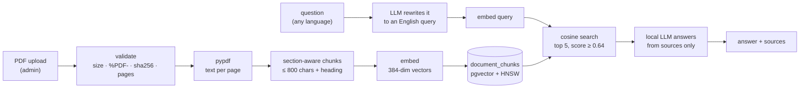

The knowledge base has 6 documents (`scripts/generate_sample_documents.py`): Returns and Exchanges, Shipping and Delivery, Size Guide, Shirt Printing, Payment FAQ and Product Care. They describe exactly what the code does (prices, carriers, printing rules, the 30-day return window), so the assistant's answers match the shop.

1. **Ingestion.** The upload is checked on its content (size, `%PDF-` signature, SHA-256 duplicates, page limit).
2. **Chunking.** The text is split into **sections by heading**, and every chunk starts with its heading ("Printed shirts: Shirts with a name…"), which makes retrieval more precise.
3. **Embeddings.** `bge-small-en-v1.5` runs locally (384 dimensions), and the vectors are stored in pgvector with an HNSW index.
4. **Query rewriting.** The local LLM turns the question into a short English query, using the conversation for context (`rag/query_rewrite.py`). The embedding model is English-only; without the rewrite, Dutch questions found the right document only a third of the time (see the evaluation).
5. **Search.** Cosine similarity in PostgreSQL; only chunks scoring ≥ 0.64 count.
6. **Answer.** The model answers **only** from the numbered sources and cites them. If nothing is relevant, the LLM isn't called and the answer is the fixed "I couldn't find enough information in the knowledge base to answer that reliably."

## AI Agent Architecture

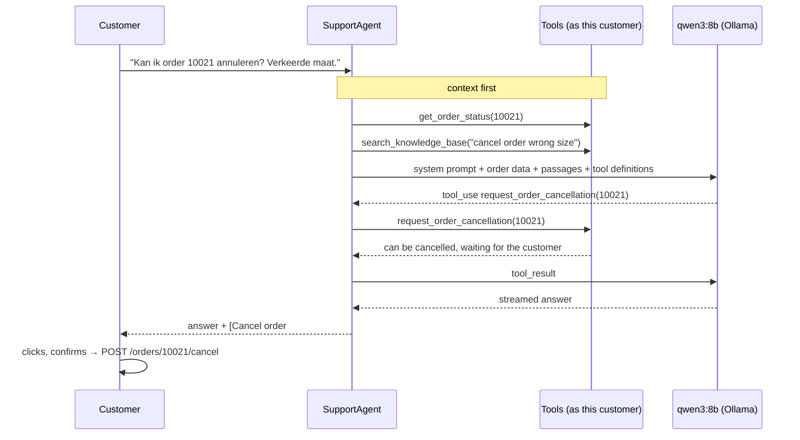

| Tool | What it does |
|---|---|
| `get_order_status(order_id)` | Status, payment, carrier, tracking number, estimated delivery, items with size and printed name |
| `get_customer_orders(status?)` | The customer's latest orders |
| `search_products(query?, size?, category?, min_price?, max_price?, on_sale?)` | Products, prices, sale prices and the sizes in stock, plus how many match |
| `search_knowledge_base(query)` | Semantic search; results are numbered `S1, S2…` for citations |
| `request_order_cancellation(order_id)` | Checks that the order can still be cancelled and *offers* it; the chat shows a confirmation button. It never cancels. |
| `create_support_ticket(subject, description, priority, order_id?)` | Opens a ticket (damaged, wrong, misprinted, lost) |
| `get_support_tickets(status?)` | The customer's tickets |

**Context first.** Testing with the real local model showed that small models often skip tools and then make things up:

| What happened | Fix |
|---|---|
| Asked about the return policy in Dutch, it answered "14 days" without searching (the policy says 30). | Before the model's first turn, the agent searches the knowledge base itself, with a rewritten query. |
| Asked about a fresh order, it skipped `get_order_status` and invented a delivery time. | The agent looks up every order number in the message itself. |
| A club in the message (also "Polder" for Polder United, with a size like "maat M") wasn't looked up reliably. | The agent searches that club's products itself. |
| "Hebben jullie shirts tussen 40-50 euro?" got "we don't have those": the tool had no price filter, and the knowledge base's "not found" instruction won over the product data. | Prices ("tussen 40-50", "onder de €60", "vanaf 70"), sale words and categories are recognised (`agents/product_intent.py`) and passed to `search_products`; when products are found, the "not found" instruction is left out and the products come last in the prompt. A regression test covers the question. |
| The same question then showed "Based on: Shirt Printing": the help-article search matched the word "shirts", and the model cited it next to the prices. | A pure product question with results skips the help-article search; it runs only when the question also touches a policy topic (printing, delivery, returns, payment, size advice, care). |

The results go into the prompt and show in the chat as real steps. The model can still call every tool itself.

**Safety rules for the tools:**

- **No `customer_id` argument:** the tools always work on the signed-in customer. In testing, the model invented a customer id, the ticket was refused and the customer got nothing. Unknown arguments are rejected with an error the model can correct.
- **The agent can't cancel anything:** `request_order_cancellation` only checks and offers; the customer's click calls the same endpoint as the order page, with a confirmation step.
- **No leaks:** the model never touches the database. Tools run as the signed-in user through the same services as the API, so someone else's order is "not found". Tests check this at unit, API and browser level.

**Streaming and persistence.** The agent runs in a worker thread and streams events over SSE. The worker has **its own database session**. Before, a customer leaving the page mid-answer closed the request's session and the new conversation was rolled back; an end-to-end test found this. The question and answer are saved together with the tool calls, sources and latency.

**What the customer sees.** The chat shows only the steps that matter to a customer (checked your order, searched our help articles) and the titles of the articles used. Tool arguments, scores and timings stay in the logs and the admin metrics.

## Testing

```bash
docker compose exec backend pytest                     # backend
docker compose exec backend sh -c "ruff check . && mypy app tests"
cd frontend && npm test && npm run lint && npm run typecheck

# Browser tests against the full stack, with the scripted model (repeatable, as in CI):
docker compose -f docker-compose.yml -f docker-compose.e2e.yml up -d --build
docker compose exec backend python scripts/seed_database.py --reset && docker compose exec backend python scripts/ingest_documents.py
cd frontend && npx playwright install chromium && npx playwright test
# … or against the real local model:  docker compose up -d --build && E2E_REAL_LLM=1 npx playwright test
```

- **Backend** (pytest against a real PostgreSQL, schema built with the migrations, a rolled-back transaction per test):
  - **Shop:** pricing rules, catalogue filters, stock limits and printing rules in the cart, guest carts and merging, checkout with server-side totals, stock that ran out in the meantime, payments (approve, decline, retry), cancel and refund, the simulator, the seed's consistency, admin products and stock.
  - **Support:** auth, rate limits, orders and tickets ownership, RAG, the agent and its tools (including cross-customer attempts and that a cancellation is only offered), streaming, metrics, log redaction.
  - **LLM:** the Ollama client against a fake Ollama server, plus an optional live test with the real model.
- **Frontend** (Vitest): the shirt colour rules, the product page (size needed, low stock, printing payload and preview), the checkout (including a regression test for a bug where the emptied cart sent you to `/cart` instead of the payment page), the cancel button (only after confirmation), the SSE parser, chat state and safe Markdown.
- **End-to-end** (Playwright, 9 tests):
  - **The shop journey:** browse → print a shirt → cart → sign in at checkout → pay → order page → ask the assistant.
  - **Cancelling via the chat:** the order is untouched until the button is pressed.
  - **Admin stock:** a size set to 0 shows as sold out in the shop.
  - **Support flows:** order questions, knowledge-base answers, another customer's order refused, admin pages, ticket handling.

For repeatable runs and CI (no GPU or 5 GB model there), `docker-compose.e2e.yml` switches to `LLM_PROVIDER=scripted`. This is a small rule-based stand-in, clearly marked as test code and refused in production. The agent loop, tools, database, search and streaming stay real. The same tests also pass with `qwen3:8b`.

**CI** (`.github/workflows/ci.yml`) runs on every push:

- **Backend:** ruff, then mypy (strict), then pytest with a pgvector service.
- **Frontend:** oxlint, then tsc, then vitest, then a build.
- When both pass, the **end-to-end** tests run against the Docker Compose stack.

## RAG Evaluation

`scripts/evaluate_rag.py` measures the knowledge base on **38 questions** about the shop (`scripts/eval/rag_eval_dataset.json`):

- 29 answerable questions (20 English, 9 Dutch), each with the document(s) that hold the answer and the facts the answer must contain;
- 9 questions the documents don't answer (gift wrapping, store opening hours, football boots, …), where "not found" is the right answer.

```bash
docker compose exec backend python scripts/evaluate_rag.py                 # retrieval (raw + rewritten) and answers, needs Ollama
docker compose exec backend python scripts/evaluate_rag.py --skip-answers  # retrieval with the raw question only
```

Measured on 2026-10-08 with `qwen3:8b` in Ollama on an Apple M4 (16 GB), threshold 0.64, after the last change to the documents. The full report is in `scripts/eval/results/latest.json`.

**Retrieval.** "Raw" searches with the question as typed; "rewritten" first lets the local LLM turn it into an English query, which is what the app does.

| Metric | Raw question | Rewritten query |
|---|---|---|
| hit@1 / hit@3 (the right document first / in the top 3) | 0.828 / 0.966 | **0.966 / 1.000** |
| hit@1 English / Dutch | 1.000 / 0.444 | 0.950 / **1.000** |
| MRR | 0.891 | **0.983** |
| Context precision (relevant chunks from the right document) | 0.765 | **0.843** |
| Fact coverage (required facts in the retrieved context) | 0.750 | **0.964** |
| Answerable questions that get context | 0.759 | **1.000** |
| Unanswerable questions stopped before the LLM | **0.889** | 0.667 |
| Search latency p50 (the rewrite adds about 0.5 s of LLM time) | 11 ms | 18 ms |

Rewriting is what makes Dutch questions work: hit@1 goes from 0.444 to 1.000. It also makes unanswerable questions look more like the documents, so fewer are stopped before the model; for those, the model is told to give the not-found message.

**Answers** (`qwen3:8b`, the full pipeline with rewriting, as in `/knowledge-base/ask`):

| Metric | All | English | Dutch |
|---|---|---|---|
| Answer correctness (all required facts in the answer) | **0.966** | 0.950 | 1.000 |
| Abstention accuracy (not-found message on unanswerable questions) | **1.000** | 1.000 | 1.000 |
| Latency p50 / p95 per answer | **4.6 s / 7.7 s** | | |

The one answer counted as wrong:

- `siz-2` ("Do the retro shirts fit the same as the new shirts?") is a real miss. The rewrite dropped the word "retro" ("product fit comparison"), so the right passage scored just below the threshold, and the answer was "not found". That is wrong, but safe.

**Choosing the threshold.** The first run used 0.60: abstention accuracy was 0.778 and answer correctness 0.897. The model then claimed things the documents don't say, for example "we don't sell football boots". The sweep showed that with rewritten queries every answerable question still gets context up to 0.64, while more unanswerable ones are stopped. So the threshold was raised to 0.64 and everything was measured again. The sweep below is from the latest run.

| Threshold (rewritten) | 0.58 | 0.60 | 0.62 | **0.64** | 0.66 | 0.68 | 0.70 |
|---|---|---|---|---|---|---|---|
| Answerable questions with context | 1.000 | 1.000 | 1.000 | **1.000** | 0.966 | 0.931 | 0.931 |
| Unanswerable stopped before the LLM | 0.333 | 0.444 | 0.667 | **0.667** | 0.889 | 1.000 | 1.000 |

Keep in mind:

- 38 questions is a small set, and the threshold was tuned on the same set.
- The model's rewrites and answers vary a little between runs (for example, hit@1 with rewriting was 0.966, 0.931 and 0.966 in three runs; in an earlier run `shp-3` was counted wrong because the correct answer didn't name the Netherlands and Belgium).
- The answer check looks for literal facts. An LLM-as-judge would measure answers with other wording more fairly.

### Observability

- **Logs:** structured JSON with a request id. LLM calls log model, tokens, latency and stop reason; tool calls log name, ok/error and duration; RAG logs chunks and best score. Never logged: passwords, tokens, keys, message texts, search queries or tool argument values. The redacting formatter is a second safety net; it once also hid harmless counters like `input_tokens`, which a test now covers.
- **Metrics:** `GET /admin/metrics` and the admin page are computed with SQL.
  - **Shop:** revenue of paid orders (refunds excluded), orders, cancellations, average order value, best sellers, sizes with low stock, orders per day.
  - **Assistant:** conversations, response latency (average and p95), tool calls per tool, knowledge-base searches, tickets, and the questions it couldn't answer, which show which documents are missing.

## Security

| Area | What's in place | How it was verified |
|---|---|---|
| Passwords | bcrypt, 72-byte limit, constant-time behaviour for unknown emails | Tests |
| JWT | HS256 with the algorithm pinned, `exp`/`sub` required, secret ≥ 32 characters, placeholder refused in production | Tests; manual `alg: none` request gives 401 |
| Authorization | Customers see only their own orders, carts, payments, tickets and chats (someone else's gives 404); admin-only routes for products, documents and metrics | Tests at API, agent and browser level |
| Prices and stock | Calculated and checked on the server; size rows locked during checkout | Tests: stock that ran out, server-side totals |
| Agent actions | Tools scoped to the signed-in customer, no `customer_id` argument, arguments validated, no destructive tool: cancelling needs the customer's click | Tests: cross-customer tool calls, cancellation only offered |
| Rate limiting | Failed logins per email; chat and RAG answers per user | Tests: 429 with `Retry-After` |
| Input and uploads | Pydantic everywhere (printing: 12 letters, 0–99); PDF size, signature and page limits | Tests |
| SQL injection | SQLAlchemy with bound parameters only | Code search |
| Browser | CSP, `X-Frame-Options: DENY`, `nosniff`; model output rendered as React elements, never raw HTML | Unit test |
| Secrets | `.env` git-ignored, placeholders in `.env.example`, throwaway values in CI; no API keys exist at all (local model) | Git history scan |

**Known limitations.** This is a portfolio project with a code review and manual checks, not a penetration test:

- The JWT is stored in `localStorage`, and there is no token revocation.
- Rate limits are in memory per process.
- HTTPS is left to a proxy in front of the stack (see Production).
- The guest cart token lives in `localStorage` too.

No card or bank data is ever handled: the payment page is in test mode, and a real provider keeps that data on its own pages.

## Going live

What is ready: the shop, the stock and price rules, the assistant, accounts, the admin, production settings and the tests. What a real launch still needs, because these are outside services with their own accounts and costs:

- **A payment provider** (for example Mollie or Stripe): replace the test-mode payment page by the provider's checkout and `POST /payments/{id}/complete` by its webhook. Until then the payment page says *Test mode* and no money moves.
- **Warehouse and carrier:** replace the simulator by the carrier's API (labels, tracking) or the warehouse system.
- **Email** for order confirmations and return labels.
- **HTTPS, a domain, backups** of the PostgreSQL volume, and legal pages (terms, privacy, imprint).
- **The real catalogue:** the demo clubs are made up; real club shirts need licences and product photos.

## Future Improvements

- Wishlists, reviews and product photos; more languages in the shop's interface.
- A bigger local model (for example `qwen3:14b` with 32 GB RAM) for better Dutch answers, and an LLM-as-judge in the evaluation.
- A stronger multilingual embedding model, measured against query rewriting.
- Human handoff: staff take over a conversation, with the assistant's trace as context.
- httpOnly cookie sessions, refresh tokens and Redis-backed rate limits; deployment behind HTTPS.
