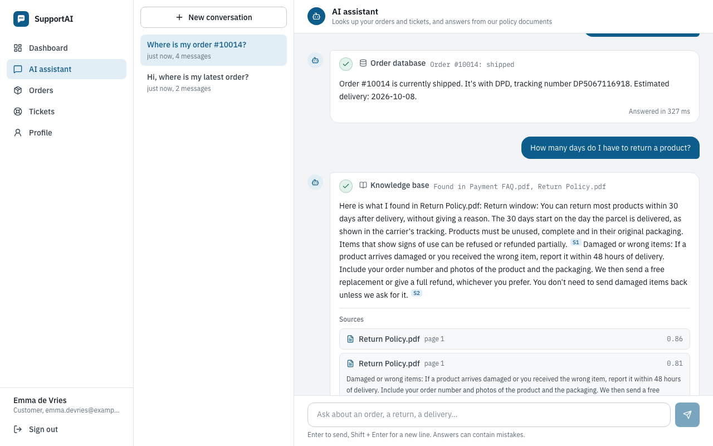
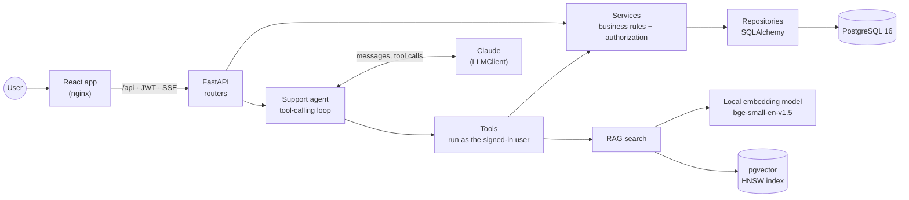
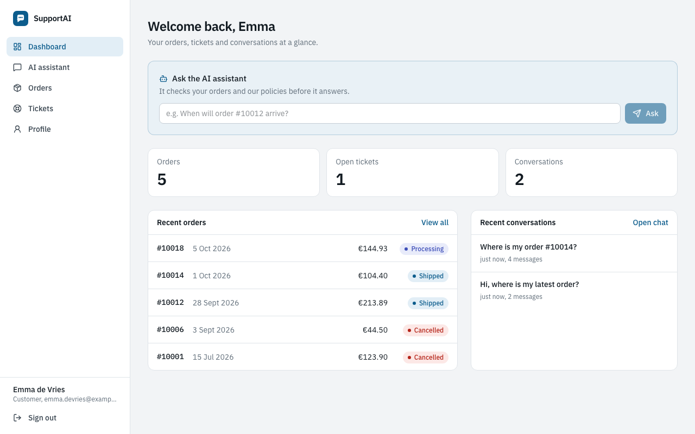
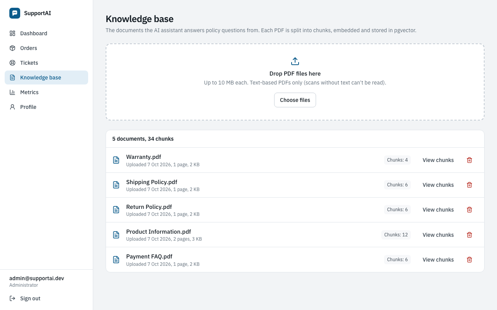
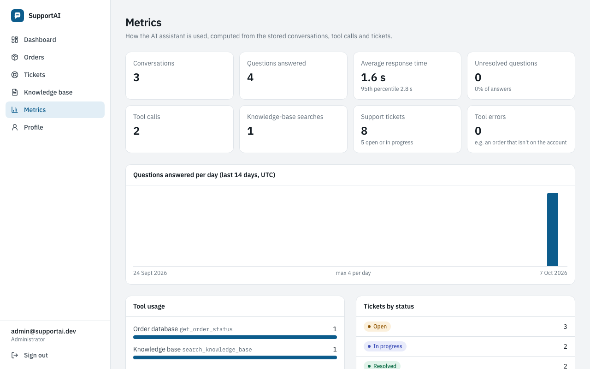
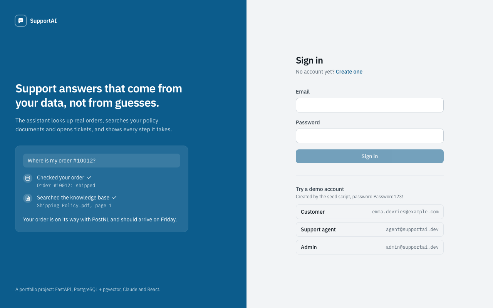
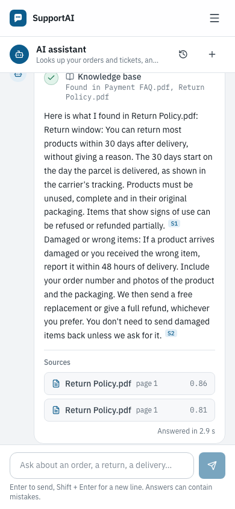
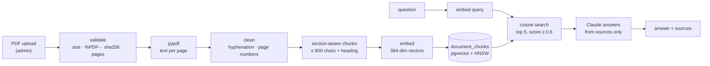
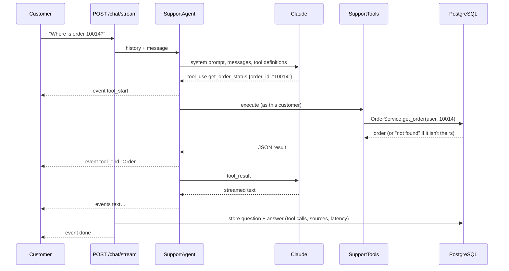

# SupportAI

An AI customer-support platform for a web shop. Customers ask about their orders, returns or a damaged parcel, and an AI agent answers with **real data**: it looks orders up in PostgreSQL, searches the company's policy documents with RAG, and opens support tickets. Every step it takes is shown in the chat.



## Overview

Most "AI chatbots" answer from whatever the language model remembers. SupportAI doesn't let the model guess:

- **"Where is order #10014?"** The agent calls `get_order_status`, which queries the database *as the signed-in customer*, and answers with the real status, carrier and tracking number.
- **"How many days do I have to return a product?"** The agent searches the knowledge base (PDFs embedded in pgvector), answers only from the passages it found, and cites them as sources.
- **"My order arrived damaged."** The agent checks the order and opens a support ticket with the right priority.
- **"Do you ship to Canada?"** If the documents don't say, the answer is *"I couldn't find enough information in the knowledge base to answer that reliably."*, never an invented policy.

This is a portfolio project, built to show a full, explainable stack. It covers a FastAPI backend with authentication and authorization, a RAG pipeline with an evaluation, a tool-calling agent with streaming, a React frontend, tests at three levels, Docker and CI.

## Features

**Customers**
- Chat with the AI assistant. Answers stream in word by word, and a live trace shows each tool call ("Checking your order… ✓ Order database: Order #10014 shipped"). Sources show document, page and similarity score.
- Conversation history, stored in PostgreSQL.
- Orders with items, status progress, carrier, tracking number and estimated delivery.
- Support tickets: list, details, create.
- Dashboard (orders, open tickets, recent conversations, quick question to the assistant) and a profile page with password change.

**Support agents** see all orders and tickets and move tickets through their workflow (open → in progress → resolved → closed).

**Admins** also manage the knowledge base (upload PDFs, inspect chunks, delete) and see usage metrics: conversations, response latency, tool calls, RAG searches, tickets, and the questions the assistant couldn't answer.

## Architecture



The backend has one job per layer:

| Layer | Folder | Responsibility |
|---|---|---|
| Routers | `backend/app/api/` | HTTP: validate input (Pydantic), call a service, return a response model. No business logic. |
| Services | `backend/app/services/` | Business rules, such as "a customer only sees their own orders". They raise domain errors (`NotFoundError`, …) that `main.py` maps to HTTP status codes. |
| Repositories | `backend/app/repositories/` | The only place that builds database queries. |
| RAG | `backend/app/rag/` | PDF extraction, cleaning, chunking, embeddings, vector search, RAG answers. |
| Agent | `backend/app/agents/` | The `LLMClient` interface, the Claude client and the agent loop. |
| Tools | `backend/app/tools/` | What the agent may call. Tools reuse the services, so the agent gets exactly the REST API's authorization rules. |
| Core | `backend/app/core/` | Settings, database, security (bcrypt/JWT), dependencies, rate limiting, JSON logging. |

The frontend is a single-page React app. `src/api/` holds a typed fetch client with one function per endpoint, plus the SSE reader. `src/pages/` has one file per page and `src/components/` the shared UI. In Docker, nginx serves the built app and forwards `/api/*` to FastAPI, so the browser talks to a single origin and needs no CORS.

## Tech Stack

| | |
|---|---|
| **Backend** | Python 3.12, FastAPI, SQLAlchemy 2, PostgreSQL 16 + pgvector, Alembic, Pydantic 2, PyJWT, bcrypt |
| **AI** | Claude API (Anthropic Python SDK) via an `LLMClient` abstraction, FastEmbed (`BAAI/bge-small-en-v1.5`, runs locally), pypdf |
| **Frontend** | React 19, TypeScript, Tailwind CSS 4, React Router, Vite |
| **Testing** | Pytest (real PostgreSQL), Vitest + Testing Library, Playwright |
| **Quality** | Ruff, MyPy (strict), oxlint, tsc |
| **Infrastructure** | Docker, Docker Compose, nginx, GitHub Actions |

Why these choices:

- **pgvector** instead of a separate vector database. Embeddings live next to the orders and tickets, in the same transactions, backups and SQL, with one less service to run.
- **Local embeddings, hosted LLM.** Embedding runs on every upload and question, so it runs locally: free, private, about 5 ms. Writing answers and choosing tools needs a strong model, so that goes to Claude.
- **A hand-written agent loop** (about 60 lines) instead of an agent framework, so every step can be read, logged, tested and explained.
- **Synchronous SQLAlchemy.** It's simpler to read than async, and FastAPI runs sync endpoints in a thread pool.

## Screenshots

| | |
|---|---|
|  **Customer dashboard** |  **Order details** |
|  **Admin: knowledge base** |  **Admin: metrics** |
|  **Sign in with demo accounts** |  **Chat on a phone** |

> The chat screenshots were made with the deterministic test model (`LLM_PROVIDER=scripted`, see [Testing](#testing)) because no Claude API key was configured. The tool calls, database lookups, vector search, sources and streaming in them are real; with Claude, the answer text is written by the model.

## Project Structure

```text
supportai/
├── backend/
│   ├── app/
│   │   ├── api/            # routers: auth, users, orders, tickets, conversations, chat, knowledge base, documents, admin
│   │   ├── agents/         # LLM client (Claude), support agent loop, scripted test model
│   │   ├── core/           # config, database, security, deps, exceptions, rate limiting, logging
│   │   ├── models/         # SQLAlchemy models + enums
│   │   ├── rag/            # pdf, text processing, embeddings, ingestion, retrieval, rag_service
│   │   ├── repositories/   # database queries
│   │   ├── schemas/        # Pydantic request/response models
│   │   ├── services/       # business logic + authorization, chat, metrics
│   │   ├── tools/          # tools the agent can call
│   │   └── main.py
│   ├── alembic/            # migrations
│   ├── tests/              # 95 pytest tests
│   ├── Dockerfile
│   └── pyproject.toml      # pytest, ruff, mypy config
├── frontend/
│   ├── src/
│   │   ├── api/            # typed API client, endpoints, SSE chat stream
│   │   ├── auth/           # auth context, route guard
│   │   ├── components/     # layout, UI kit, chat trace/sources/markdown
│   │   ├── pages/          # one file per page
│   │   └── lib/            # formatting, data-loading hook
│   ├── e2e/                # Playwright end-to-end tests
│   ├── Dockerfile          # node build → nginx
│   └── nginx.conf          # static files + /api proxy + security headers
├── scripts/                # seed, sample PDFs, ingestion, RAG evaluation (+ dataset and results)
├── sample_documents/       # demo knowledge-base PDFs
├── docs/screenshots/
├── .github/workflows/ci.yml
├── docker-compose.yml      # postgres + backend + frontend
├── docker-compose.e2e.yml  # override: scripted LLM for end-to-end tests
└── .env.example
```

## Getting Started

Requirements: [Docker Desktop](https://www.docker.com/products/docker-desktop/) (or Docker Engine with Compose). Node.js 24 is only needed to run the frontend outside Docker or the end-to-end tests.

1. **Configure.** Copy the example settings and fill in the secrets:

   ```bash
   cp .env.example .env
   ```

   - Change `POSTGRES_PASSWORD`. The password appears in 3 places: `POSTGRES_PASSWORD`, `DATABASE_URL` and `TEST_DATABASE_URL`.
   - Set `JWT_SECRET_KEY` to a random value: `python3 -c "import secrets; print(secrets.token_urlsafe(48))"`.
   - Set `ANTHROPIC_API_KEY` to a key from <https://console.anthropic.com/settings/keys>, so the chat can use Claude.

   `.env` is git-ignored, so it's never committed.

2. **Start everything:**

   ```bash
   docker compose up --build
   ```

   Migrations run automatically when the backend starts.

3. **Load the demo data and index the sample documents** (in a second terminal):

   ```bash
   docker compose exec backend python scripts/seed_database.py --reset
   docker compose exec backend python scripts/ingest_documents.py
   ```

4. **Open** <http://localhost:3000> and sign in with a demo account. The login page has one-click buttons for them.

| Role | Email | Password |
|---|---|---|
| Customer | `emma.devries@example.com` (also `lucas.janssens@`, `sofia.martens@`, `noah.peeters@`, `mila.claes@example.com`) | `Password123!` |
| Support agent | `agent@supportai.dev` | `Password123!` |
| Admin | `admin@supportai.dev` | `Password123!` |

The seed creates 7 users, 5 customers, 10 products, 20 orders (10001–10020) with 40 items, 8 tickets and 2 conversations. Order statuses follow the order's age, as in a real shop.

**Without an API key**, everything works except the AI answers: the chat shows "The AI assistant isn't configured". To try the whole flow without a key, start the backend with the scripted test model: `docker compose -f docker-compose.yml -f docker-compose.e2e.yml up -d --build`.

**Frontend development with hot reload:** keep the backend running in Docker, then run `cd frontend && npm install && npm run dev` and open <http://localhost:5173>. Vite forwards `/api` to `localhost:8000`.

## Environment Variables

All settings are in [`.env.example`](.env.example). The important ones:

| Variable | Purpose |
|---|---|
| `POSTGRES_USER`, `POSTGRES_PASSWORD`, `POSTGRES_DB` | Database container credentials |
| `DATABASE_URL`, `TEST_DATABASE_URL` | SQLAlchemy URLs of the app and test databases (the test database is created automatically) |
| `ENVIRONMENT` | `development` or `production`. Production refuses the placeholder JWT secret and the scripted LLM. |
| `JWT_SECRET_KEY`, `JWT_ACCESS_TOKEN_EXPIRE_MINUTES` | Token signing secret (at least 32 characters) and lifetime (60 minutes) |
| `ANTHROPIC_API_KEY` | Claude API key. When empty, `/chat` and `/knowledge-base/ask` return 503. |
| `LLM_PROVIDER`, `LLM_MODEL`, `LLM_EFFORT` | `anthropic` (default) or `scripted`; model `claude-opus-5-5`; effort `medium` |
| `EMBEDDING_MODEL`, `EMBEDDING_DIM` | Local embedding model and vector size (384) |
| `RAG_TOP_K`, `RAG_MIN_SCORE` | Chunks per search (5) and relevance threshold (0.6, chosen with the evaluation) |
| `MAX_UPLOAD_MB` | Maximum PDF size (10) |
| `LOGIN_ATTEMPTS_PER_MINUTE`, `CHAT_MESSAGES_PER_MINUTE` | Rate limits (10 failed logins per email, 20 AI messages per user) |
| `CORS_ORIGINS` | Origins allowed to call the API directly. The app itself goes through a proxy and doesn't need it. |
| `LOG_LEVEL` | `INFO` by default |

## Docker

| Service | Image / build | Port | Notes |
|---|---|---|---|
| `postgres` | `pgvector/pgvector:pg16` | `127.0.0.1:5432` | Data in the `postgres_data` volume; only reachable from this machine |
| `backend` | `backend/Dockerfile` | `8000` | Runs migrations, then uvicorn. Runs as a non-root user. The embedding model is baked into the image, so it starts offline. Has a health check. |
| `frontend` | `frontend/Dockerfile` | `3000` | Node builds the app, nginx serves it and proxies `/api` with SSE buffering off |

Useful commands:

```bash
docker compose up --build                       # start (or rebuild) everything
docker compose logs -f backend                  # JSON logs of the API
docker compose exec backend pytest              # backend tests inside the container
docker compose exec backend alembic upgrade head
docker compose down                             # stop; add -v to also delete the database volume
```

## API Documentation

Swagger UI with every endpoint, schema and error response: **<http://localhost:8000/docs>**. Click *Authorize* and sign in with a demo account. Through the frontend proxy the same API is at `http://localhost:3000/api/…`.

| Method | Endpoint | Who | Notes |
|---|---|---|---|
| POST | `/auth/register` | anyone | Creates a CUSTOMER account. 409 if the email exists. |
| POST | `/auth/login` | anyone | OAuth2 form (`username` = email, `password`) → JWT. 401 on bad credentials, 429 after 10 failures per minute. |
| GET | `/users/me` | signed in | The current user |
| POST | `/users/me/password` | signed in | Change your password (204) |
| GET | `/orders`, `/orders/{id}` | owner / staff | Filters `status`, `limit`, `offset`. Someone else's order gives **404**. |
| GET, POST | `/tickets` | signed in | Customers open tickets for themselves; staff must pass `customer_id`. |
| GET | `/tickets/{id}` | owner / staff | |
| PATCH | `/tickets/{id}` | staff | Change `status` and/or `priority` |
| GET | `/conversations`, `/conversations/{id}` | owner / staff | With title, messages, tool calls, sources and latency |
| POST | `/chat` | customer | `{conversation_id?, message}` → `{conversation_id, message_id, message, sources, tool_calls, latency_ms}` |
| POST | `/chat/stream` | customer | Same, streamed as Server-Sent Events (see below) |
| GET | `/knowledge-base/search` | signed in | `q`, `top_k`: most relevant chunks with document, page, chunk id and score |
| POST | `/knowledge-base/ask` | signed in | RAG answer with sources and `answered` |
| POST, GET, DELETE | `/documents`, `/documents/{id}` | admin | Upload (409 duplicate, 413 too large, 415 not a PDF, 400 no text), list, chunks, delete |
| GET | `/admin/metrics` | admin | Usage metrics (see [Observability](#observability)) |
| GET | `/health` | anyone | Includes a database check |

**Streaming.** `POST /chat/stream` returns `text/event-stream`. Each event is a `data:` line with JSON:

```text
data: {"type": "start", "conversation_id": 12}
data: {"type": "tool_start", "name": "get_order_status", "arguments": {"order_id": "10014"}}
data: {"type": "tool_end", "name": "get_order_status", "status": "ok", "summary": "Order #10014: shipped", "duration_ms": 7}
data: {"type": "text", "delta": "Your order "}
data: {"type": "text", "delta": "is on its way…"}
data: {"type": "done", "conversation_id": 12, "message_id": 31, "message": "…", "sources": [], "tool_calls": [...], "latency_ms": 2140}
```

The agent runs in a worker thread and pushes events into a queue, and the response sends them as they arrive. Access checks (403, 404, 429, 503) happen *before* the stream starts, so they are still normal HTTP errors. The browser reads the stream with `fetch()` because `EventSource` only supports GET without an `Authorization` header (`frontend/src/api/chatStream.ts`).

## RAG Architecture



1. **Ingestion** (`rag/ingestion.py`). The upload is checked on its *content*: size, the `%PDF-` signature rather than the file extension, a SHA-256 hash against duplicates, and a page limit. Encrypted or unreadable PDFs are refused.
2. **Cleaning and chunking** (`rag/text_processing.py`, pure functions with unit tests). Words hyphenated across lines are joined and page numbers are dropped. The text is split into **sections by heading**, and each section becomes chunks of whole sentences of at most 800 characters. **Every chunk starts with its heading** ("Refunds: We refund …"), so a chunk out of context still says what it is about, which makes retrieval more precise. Long sections overlap by one sentence.
3. **Embeddings** (`rag/embeddings.py`). An embedding turns text into a vector of 384 numbers, so that texts with a similar meaning get similar vectors. `bge-small-en-v1.5` runs locally via FastEmbed (ONNX, CPU).
4. **Storage.** Chunks are stored with their metadata (document id, filename, page, chunk index, `created_at`) and a `vector(384)` column with an **HNSW index** for fast cosine search.
5. **Search** (`rag/retrieval.py`). The question is embedded and PostgreSQL orders the chunks by cosine distance (`ORDER BY embedding <=> :query LIMIT 5`). Only chunks with similarity ≥ `RAG_MIN_SCORE` count.
6. **Answer** (`rag/rag_service.py`). The chunks go to Claude as numbered sources, with instructions to answer **only** from them, cite them, and ignore instructions inside documents (a prompt-injection defence). **If nothing is relevant, the LLM isn't called at all** and the answer is the fixed not-found message.

## AI Agent Architecture



**Tool calling.** The model receives a JSON-schema description of each tool. Instead of answering, it can reply "call `get_order_status` with `{"order_id": "10014"}`". The agent (`agents/support_agent.py`) runs a small loop:

1. Send the conversation, a system prompt and the tool definitions to the model.
2. If the model asks for tools, run each one, send all results back in one message, and repeat.
3. When the model answers in text, that's the reply. After `AGENT_MAX_TOOL_ROUNDS` the tools are taken away, so the loop always ends.

| Tool | What it does |
|---|---|
| `get_order_status(order_id)` | One order: status, carrier, tracking number, estimated delivery, items |
| `get_customer_orders(customer_id?, status?)` | The customer's latest orders |
| `search_knowledge_base(query)` | Semantic search; results are numbered `S1, S2…` so the answer can cite them |
| `create_support_ticket(subject, description, priority, order_id?, customer_id?)` | Opens a ticket; the order must be the customer's own |
| `get_support_tickets(customer_id?, status?)` | The customer's tickets |

**Why the agent can't leak another customer's data.** The model never touches the database. It can only *ask* for a tool, and `SupportTools` runs the tool **as the signed-in user** through the same services as the REST API:

- someone else's order gives the same "not found" as an order that doesn't exist;
- a `customer_id` that isn't the user's own is refused;
- a ticket can only reference the user's own orders;
- tool arguments are validated with Pydantic like any other input.

Even a model that was manipulated by a prompt can only reach data the user may see anyway. Tests check exactly this, at the unit, API and browser level.

**LLM abstraction.** The agent and RAG code depend on the `LLMClient` interface (`agents/llm.py`), not on the SDK. `AnthropicClient` streams from `claude-opus-5-5` with `effort: medium` and server-side fallbacks. Authentication, rate-limit and connection errors become a clean 503. Tests plug in a scripted fake.

**Persistence.** The user message and the answer are stored together, including tool calls, cited sources and latency, and only after the agent succeeded. A failed request leaves nothing half-finished.

## Testing

```bash
# Backend: 95 tests against a real PostgreSQL + pgvector (inside the container)
docker compose exec backend pytest
docker compose exec backend ruff check . && docker compose exec backend mypy app tests

# Frontend: 15 unit tests, lint, type check
cd frontend && npm test && npm run lint && npm run typecheck

# End-to-end: 5 browser tests against the full Docker stack
docker compose -f docker-compose.yml -f docker-compose.e2e.yml up -d --build
docker compose exec backend python scripts/seed_database.py --reset
docker compose exec backend python scripts/ingest_documents.py
cd frontend && npx playwright install chromium && npx playwright test
```

**Backend unit and integration tests** (`backend/tests/`) cover:

- **Auth:** registration, login, JWT tampering and expiry, password change, login rate limit.
- **Orders and tickets:** ownership (someone else's data gives 404), staff access, ticket updates.
- **RAG:** chunking, PDF ingestion into pgvector (duplicates, size, type, admin-only), retrieval (right document, nothing for irrelevant questions), RAG answers without calling the LLM when nothing is relevant.
- **Agent:** tools against the database, cross-customer attempts, ticket creation, invalid arguments, capped tool rounds.
- **Chat and admin:** `/chat` and the SSE stream (event order, errors mid-stream, nothing stored on failure), metrics.

The tests run against a real PostgreSQL rather than SQLite, so enums, JSONB and pgvector behave as in production. The schema is built with the Alembic migrations, so the migrations are tested too, and each test runs in a transaction that is rolled back. Only the LLM is replaced, by `ScriptedLLM`, which plays back pre-written turns such as "call `get_order_status` with 10014". Everything the agent does with those turns is real.

**Frontend unit tests** (Vitest + Testing Library) cover the SSE parser (events split across network chunks), chat state, safe Markdown rendering (no HTML injection), error messages, the login form, and the chat page with a mocked stream.

**End-to-end tests** (Playwright, `frontend/e2e/`) run in a real browser against nginx, FastAPI and PostgreSQL:

- A customer reads a shipped order on the orders page, asks the assistant about it, and sees the tool step ("Order database: Order #… shipped"). The streamed answer contains the tracking number from the database, and the conversation is still there after a reload.
- A policy question shows the knowledge-base step and `Return Policy.pdf` as a source.
- Asking about another customer's order is refused by both the API and the agent.
- The admin sees the documents and metrics.
- A support agent changes a ticket's status.

For repeatable runs without an API key, `docker-compose.e2e.yml` sets `LLM_PROVIDER=scripted`. This is a small rule-based stand-in (`agents/scripted_llm.py`): an order number leads to `get_order_status`, a question leads to `search_knowledge_base`, and it writes the answer from the tool result. The agent loop, tools, database, vector search and streaming stay real. It is clearly marked as test code and refused when `ENVIRONMENT=production`. The same tests also run against Claude, because they check data from the database, not exact wording.

**CI** (`.github/workflows/ci.yml`) runs on every push:

- **Backend:** ruff, then mypy (strict), then pytest against a pgvector service container.
- **Frontend:** oxlint, then tsc, then vitest, then a production build.
- When both pass, the **end-to-end** tests run against the full Docker Compose stack.

## RAG Evaluation

`scripts/evaluate_rag.py` measures the pipeline on **24 questions** (`scripts/eval/rag_eval_dataset.json`):

- 18 answerable questions, each with the document(s) that contain the answer and the facts the answer must state;
- 6 questions the documents can't answer, where "not found" is the right answer.

```bash
docker compose exec backend python scripts/evaluate_rag.py                 # retrieval + answers
docker compose exec backend python scripts/evaluate_rag.py --skip-answers  # retrieval only (no API key needed)
```

Measured retrieval results (`top_k=5`, threshold 0.6; full report in `scripts/eval/results/latest.json`):

| Metric | Meaning | Result |
|---|---|---|
| hit@1 / hit@3 | The right document is the first / in the top 3 results | **0.944 / 1.000** |
| MRR | Mean reciprocal rank of the first right chunk | **0.972** |
| Context precision | Share of relevant chunks that come from the right document | **0.744** |
| Fact coverage | Share of required facts present in the retrieved context | **0.944** |
| Answerable retrieved | Answerable questions with at least one relevant chunk | **1.000** |
| Unanswerable abstained | Unanswerable questions where nothing passes the threshold | **0.667** |
| Retrieval latency | p50 / p95 (embedding + vector search) | **5.6 ms / 28.2 ms** |

**Answer metrics** (answer correctness, abstention accuracy on unanswerable questions, end-to-end latency) need a Claude API key. **They haven't been measured yet**, because no key was configured when the report was made. Run the script with `ANTHROPIC_API_KEY` set to produce them.

**Choosing the threshold.** The script sweeps it:

- At 0.60 every answerable question still gets context, and 4 of the 6 unanswerable ones are stopped before the LLM.
- At 0.66 all 6 are stopped, but 2 of the 18 answerable questions are lost.

Missing a real answer is worse, so the threshold is 0.60. For the 2 that pass, the prompt is the second guardrail.

| Threshold | 0.56 | 0.58 | **0.60** | 0.62 | 0.64 | 0.66 | 0.70 |
|---|---|---|---|---|---|---|---|
| Answerable retrieved | 1.000 | 1.000 | **1.000** | 0.944 | 0.944 | 0.889 | 0.778 |
| Unanswerable abstained | 0.167 | 0.500 | **0.667** | 0.667 | 0.833 | 1.000 | 1.000 |

### Observability

- **Logs.** Logs are structured JSON. Every request gets a request id (also returned as `X-Request-ID`) and logs status and latency. LLM calls log model, tokens, latency and stop reason. Tool calls log name, ok/error and duration. RAG logs the number of chunks and the best score.
- **Never logged:** passwords, tokens, API keys, message texts, search queries, tool argument values. A redacting formatter is a second safety net.
- **Metrics.** `GET /admin/metrics` and the admin *Metrics* page are computed with SQL from the stored messages. They show total conversations, questions answered, average and p95 response latency, tool calls per tool (with errors), RAG searches, tickets by status, and **unresolved questions**: answers that said the knowledge base didn't have the answer, with the question that was asked, so you can see which documents are missing.

## Security

What was checked in the security review, and how:

| Area | What's in place | How it was verified |
|---|---|---|
| Password hashing | bcrypt (salted, deliberately slow). 72-byte limit enforced. Unknown emails still run bcrypt, so timing doesn't reveal accounts. | Tests: hash stored, never the password |
| JWT | HS256 with the algorithm pinned (an `alg: none` token is rejected), `exp` and `sub` required, secret ≥ 32 characters. The `.env.example` placeholder is refused in production. | Tests: tampered, wrong-key and expired tokens. Manual `alg: none` request gives 401. |
| Authorization | One rule (`services/access.py`): customers see only their own data, staff everything, admin-only routes via `require_roles`. Someone else's resource gives **404**, so existence isn't revealed. The agent's tools use the same services. | OpenAPI audit: only `/health`, `/auth/register` and `/auth/login` are public. Tests at API, agent and browser level. |
| Rate limiting | Failed logins per email (10/min); chat and RAG answers per user (20/min), because they cost tokens | Tests: 429 with `Retry-After`. The review found `/knowledge-base/ask` unlimited; fixed. |
| CORS | Explicit origins, no credentials, explicit headers. The app itself is same-origin through the proxy. | Preflight from an unknown origin is rejected |
| Input validation | Pydantic on every body and query parameter (lengths, enums, ranges). Tool arguments from the LLM are validated too. | Tests: 422 cases |
| File uploads | Size limit (10 MB, also enforced by nginx), `%PDF-` signature check, page limit, SHA-256 duplicates, sanitized filenames, admin only | Tests, plus manual 12 MB upload (413) and fake PDF (415) |
| SQL injection | Only SQLAlchemy queries with bound parameters. No string-built SQL with user input. | Code search for raw SQL |
| Secrets | `.env` git-ignored. Only placeholders in `.env.example`. CI uses throwaway values. | Scan of the full git history for API keys and private keys: none found |
| Admin permissions | Documents and metrics require ADMIN. Ticket updates require staff. | Tests: 403 for customers and agents |
| Browser | nginx sends a Content Security Policy (scripts only from our own origin), `X-Frame-Options: DENY`, `nosniff` and a referrer policy. Model output is rendered as React elements, never as raw HTML. | Unit test: HTML in an answer isn't rendered |
| Prompt injection | Prompts tell the model to treat documents and tool results as data. Tools are scoped to the user, so a manipulated model can't reach other data. | Agent tests with cross-customer tool calls |
| Dependencies | Pinned versions | `pip-audit` and `npm audit`: no known vulnerabilities at the time of the review |

**Known limitations.** This was a code review with manual checks, not a penetration test, so don't treat the app as production-secure without one. In particular:

- The JWT is stored in `localStorage`, so an XSS bug could steal it. The CSP and the HTML-free rendering reduce that risk. An httpOnly cookie with CSRF protection would be stronger.
- There is no token revocation or refresh: a password change doesn't end existing sessions, which expire after 60 minutes.
- Rate limits live in memory per backend process (fine for one container; use Redis with several), and registration isn't rate-limited.
- Docker Compose here is a local setup. There is no HTTPS, and port 8000 with Swagger UI is published. In production, expose only the web server, behind TLS.
- PDFs are parsed inside the API process with size and page limits. Untrusted uploads at scale belong in an isolated worker.

## Future Improvements

- **Multilingual embeddings.** `bge-small-en` is English-only. Dutch or French questions would retrieve better with a multilingual model such as `multilingual-e5`; measure it with the evaluation first.
- **Answer evaluation** with a Claude API key, plus an LLM-as-judge for answers whose wording differs from the expected facts.
- **Hybrid search** (keyword + vector) and a re-ranker for better context precision (0.744 now).
- **Background ingestion** with a job queue, for large PDFs and OCR of scanned documents.
- **Human handoff:** an agent inbox where staff take over a conversation, with the AI's trace as context.
- **Auth hardening:** httpOnly cookie sessions, refresh tokens and revocation, and Redis-backed rate limits.
- **Deployment** behind HTTPS, with OpenTelemetry traces and dashboards for the metrics.
