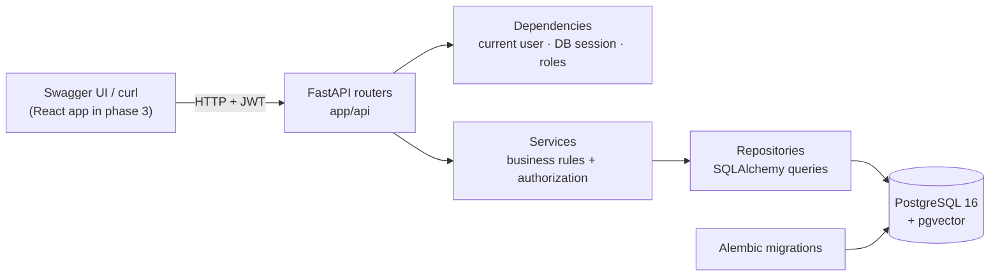
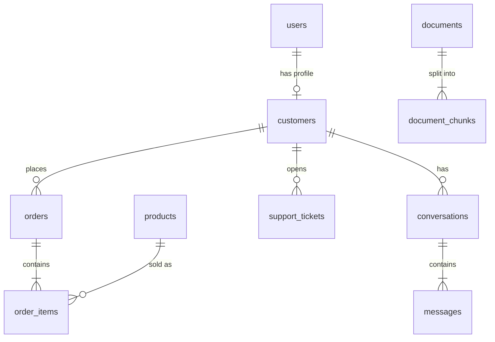

# SupportAI

An AI customer-support platform: customers ask about their orders, return policy or a damaged parcel, and an AI agent answers using **real data** — it looks orders up in the database, searches company documents with RAG, and opens support tickets.

> **Status:** Phase 1 (backend & foundation) is complete. The RAG pipeline and AI agent (phase 2) and the React frontend (phase 3) are next.

## Architecture



Each layer has one job:

| Layer | Folder | Responsibility |
|---|---|---|
| Routers | `app/api/` | HTTP: parse and validate input (Pydantic), call a service, return a response model. No business logic. |
| Services | `app/services/` | Business rules, such as "a customer only sees their own orders". They raise domain errors (`NotFoundError`, …) that `main.py` turns into HTTP status codes. |
| Repositories | `app/repositories/` | The only place that builds database queries. |
| Models | `app/models/` | SQLAlchemy ORM classes = database tables. |
| Schemas | `app/schemas/` | Pydantic models for request and response bodies (what the API exposes). |
| Core | `app/core/` | Settings, database session, password hashing / JWT, shared dependencies. |

`agents/`, `rag/` and `tools/` are in place for phase 2.

## Tech stack

**Backend:** Python 3.12 · FastAPI · SQLAlchemy 2 · PostgreSQL 16 + pgvector · Alembic · Pydantic 2 · PyJWT · bcrypt
**Quality:** Pytest (against a real PostgreSQL) · Ruff · MyPy (strict)
**Infrastructure:** Docker · Docker Compose

## Getting started

Requirements: Docker Desktop (or Docker Engine + Compose).

```bash
cp .env.example .env          # then change POSTGRES_PASSWORD (in all 3 places) and JWT_SECRET_KEY
docker compose up --build     # starts PostgreSQL and the API; migrations run automatically
```

In a second terminal, load the demo data:

```bash
docker compose exec backend python scripts/seed_database.py          # empty database only
docker compose exec backend python scripts/seed_database.py --reset  # wipe and re-seed
```

Then open **http://localhost:8000/docs** (Swagger UI).

### Demo accounts

All demo accounts use the password `Password123!`.

| Role | Email |
|---|---|
| ADMIN | `admin@supportai.dev` |
| AGENT (support staff) | `agent@supportai.dev` |
| CUSTOMER | `emma.devries@example.com`, `lucas.janssens@example.com`, `sofia.martens@example.com`, `noah.peeters@example.com`, `mila.claes@example.com` |

The seed creates 7 users, 5 customers, 10 products, 20 orders (order numbers 10001–10020) with 40 order items, 8 support tickets and 2 conversations. Order statuses follow the order's age, like in a real shop: today's order is `pending`, last week's are `shipped` with a carrier and tracking number, older ones are `delivered` or `cancelled`.

## Trying the API

**In Swagger UI:** click **Authorize**, enter a demo email as *username* plus the password, then try any endpoint.

**With curl:**

```bash
# Log in (OAuth2 password flow: form fields, the email goes in "username")
TOKEN=$(curl -s -X POST localhost:8000/auth/login \
  -d "username=emma.devries@example.com&password=Password123!" | python3 -c "import sys,json; print(json.load(sys.stdin)['access_token'])")

curl -H "Authorization: Bearer $TOKEN" localhost:8000/users/me
curl -H "Authorization: Bearer $TOKEN" "localhost:8000/orders?status=shipped"
curl -H "Authorization: Bearer $TOKEN" localhost:8000/orders/10012

curl -X POST localhost:8000/tickets -H "Authorization: Bearer $TOKEN" -H "Content-Type: application/json" \
  -d '{"subject": "Parcel arrived damaged", "description": "The box was crushed and a mug is broken.", "priority": "high"}'
```

Asking for another customer's order returns **404**, exactly like an order that doesn't exist.

## API

| Method | Endpoint | Who | Notes |
|---|---|---|---|
| POST | `/auth/register` | anyone | Creates a CUSTOMER account + profile. 201, or 409 if the email exists. |
| POST | `/auth/login` | anyone | Form fields `username` (email) and `password`; returns a JWT. 401 on bad credentials. |
| GET | `/users/me` | signed in | The current user. |
| GET | `/orders` | signed in | Own orders; staff see all. Filters: `status`, `limit`, `offset`. |
| GET | `/orders/{order_id}` | owner / staff | Includes items, carrier, tracking number and estimated delivery. |
| GET | `/tickets` | signed in | Own tickets; staff see all. Filters: `status`, `limit`, `offset`. |
| POST | `/tickets` | signed in | Customers open tickets for themselves; staff must pass `customer_id`. |
| GET | `/tickets/{ticket_id}` | owner / staff | |
| GET | `/conversations` | signed in | Own conversations with message counts. |
| GET | `/conversations/{conversation_id}` | owner / staff | Includes all messages. |
| GET | `/health` | anyone | Also checks the database connection. |

Lists return `{"items": [...], "total": n, "limit": 20, "offset": 0}`.

## Database



- `users` holds login accounts with a `role` (CUSTOMER, AGENT, ADMIN). Customers also get a row in `customers`, which links their orders, tickets and conversations.
- Statuses, priorities and roles are native PostgreSQL enums, so the database itself rejects invalid values.
- Money is stored as `NUMERIC(10,2)`, never as a float, so `0.1 + 0.2` stays exact.
- `order_items.price` is the price *at the time of purchase*, so later price changes don't alter old orders.
- `document_chunks.embedding` is a `vector(384)` column with an HNSW index for cosine similarity. It's used by the RAG pipeline in phase 2.

Migrations live in `backend/alembic/versions/` and run automatically when the backend container starts. To run them by hand: `docker compose exec backend alembic upgrade head`.

## Testing

```bash
docker compose exec backend pytest                 # 34 tests
docker compose exec backend ruff check .           # lint
docker compose exec backend mypy app               # strict type checking
```

The tests run against a **real PostgreSQL** database (`supportai_test`), not SQLite, so they test exactly what runs in production, including enums and pgvector. The test run:

1. creates the test database if needed and builds the schema with the Alembic migrations (so the migrations are tested too);
2. runs every test inside a transaction that is rolled back afterwards, so tests never see each other's data. Service code that calls `commit()` only releases a savepoint.

What's covered: registration (validation, duplicates, hashing, no self-promotion to ADMIN), login, JWT validation (tampered, wrong key, expired), order retrieval with items, ownership checks (other customers' orders, tickets and conversations return 404), staff access, ticket creation (customer, staff on behalf of a customer, validation), filtering and pagination.

## Design decisions

These are short explanations of why things are built this way.

- **Layered architecture.** Routers stay thin, so the rules live in one place (services) and the queries in another (repositories). That makes each part easy to test and to change. For example, the AI agent in phase 2 will reuse the same services, so it gets the same authorization rules for free.
- **Authentication.** Passwords are hashed with **bcrypt**, which is slow on purpose and salted, so stolen hashes are hard to crack. On login the server issues a **JWT**: a signed token holding the user id, role and expiry time. Each request sends it as `Authorization: Bearer …`; the server checks the signature and expiry, so it needs no session storage. Unknown emails still run bcrypt, so response time doesn't reveal which emails are registered.
- **Authorization.** One rule in `services/access.py`: customers are limited to their own `customer_id`, staff (ADMIN/AGENT) see everything. Someone else's order returns **404, not 403**, so the API doesn't confirm the order exists.
- **Domain errors.** Services raise `NotFoundError`, `ConflictError` and so on, without importing anything from HTTP. One exception handler in `main.py` maps them to status codes.
- **Synchronous SQLAlchemy.** This is simpler to read and explain than async; FastAPI runs sync endpoints in a thread pool, which is plenty for this workload.
- **Order numbers start at 10001** (`IDENTITY START 10001`), so they look like real order numbers, the kind a customer quotes to the AI agent in phase 2.
- **pgvector instead of a separate vector database.** Embeddings sit next to the relational data, in the same transactions, backups and SQL queries, with one less service to run.

## Project structure

```text
supportai/
├── backend/
│   ├── app/
│   │   ├── api/            # routers: auth, users, orders, tickets, conversations, health
│   │   ├── core/           # config, database, security (bcrypt/JWT), deps, exceptions
│   │   ├── models/         # SQLAlchemy models + enums
│   │   ├── schemas/        # Pydantic request/response models
│   │   ├── services/       # business logic + authorization
│   │   ├── repositories/   # database queries
│   │   ├── agents/ rag/ tools/   # phase 2
│   │   └── main.py
│   ├── alembic/            # migrations
│   ├── tests/
│   ├── Dockerfile
│   ├── pyproject.toml      # pytest, ruff, mypy config
│   └── requirements*.txt
├── frontend/               # phase 3
├── scripts/seed_database.py
├── docker-compose.yml
└── .env.example
```

## Environment variables

See [`.env.example`](.env.example). The important ones:

| Variable | Purpose |
|---|---|
| `DATABASE_URL` | SQLAlchemy URL of the main database |
| `TEST_DATABASE_URL` | Database used by the test suite (created automatically) |
| `JWT_SECRET_KEY` | Secret used to sign tokens; at least 32 characters |
| `JWT_ACCESS_TOKEN_EXPIRE_MINUTES` | Token lifetime (default 60) |
| `CORS_ORIGINS` | Comma-separated browser origins allowed to call the API |
| `EMBEDDING_DIM` | Size of the embedding vectors (phase 2) |

`.env` is git-ignored; never commit real secrets.

## Roadmap

- **Phase 2:** PDF ingestion → chunking → embeddings → pgvector; semantic search; RAG answers with sources; an AI agent with tool calling (order lookup, knowledge-base search, ticket creation); `POST /chat`; logging; RAG evaluation.
- **Phase 3:** React + TypeScript + Tailwind frontend, streaming chat, admin knowledge base, metrics, CI/CD with GitHub Actions, end-to-end tests.
